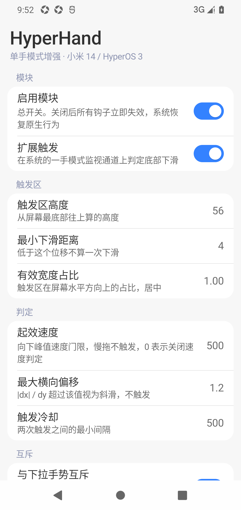
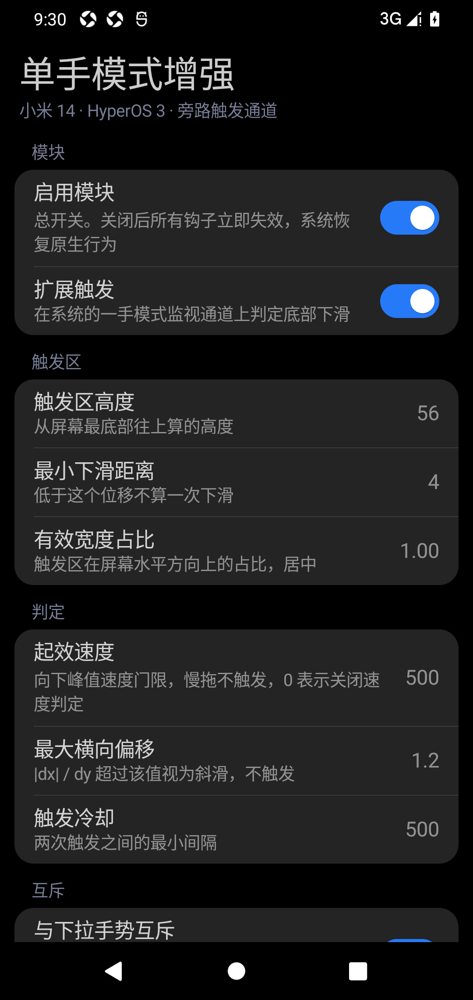
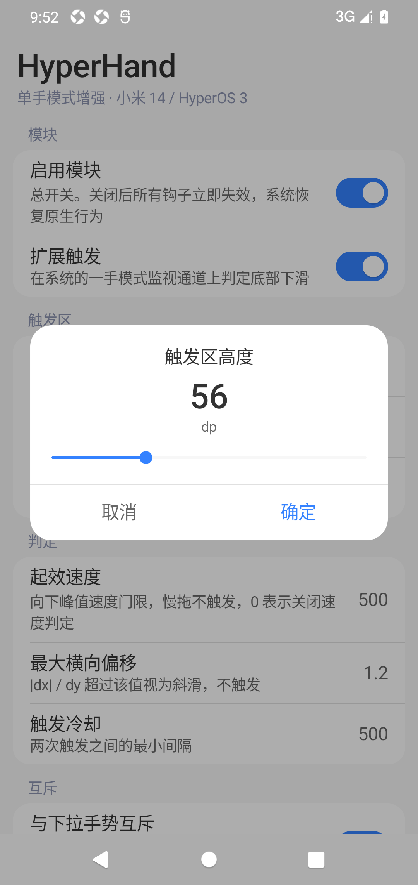

<div align="center">

# HyperHand · 单手模式增强

**给小米 14 / HyperOS 3（Android 16）的原生单手模式，加上一颗"iPhone 式"的下拉触发**

只改触发层 —— 缩小动画、缩小布局、触摸映射、退出方式 100% 沿用系统原生实现。

[](#验证环境)
[](#模块声明与-api-102)
[](#安装)
[](LICENSE)

</div>

---

## 它解决什么问题

MIUI / HyperOS 的单手模式入口是"在屏幕最底部的小白条（胶囊条）上向下滑"。这个入口有两个硬伤：

1. **落指区域只有 25dp（本机 76px）**。手指稍微高一点，事件根本进不了 `NavStubView`，直接被 App 拿走 → 手感极差、成功率低。
2. **无法调节**。触发区高度是 `NavStubView.getHotSpaceHeight()` 里的硬编码常量 `25.0f`，不是资源，`settings` 里也没有开关，RRO 也改不了。

本模块把触发区扩大到 56dp（可配），并加入**速度判定**与**意图判别**，让"底部快甩 = 单手模式、慢拖 = 正常滑动、上方下拉 = 通知/控制中心"三者互不打架。

## 特性

- **扩大触发区**：底部 56dp（默认）/ 可配到任意高度，居中宽度可裁切。
- **速度门限**：按向下**峰值速度**判定（默认 ≥500 px/s）—— 慢拖永不触发、快甩必定触发，可调 0 关闭。
- **意图判别（三道闸门）**：与桌面"下拉打开通知/控制中心"手势互斥，不会出现"想进单手却开了通知中心"。
- **与原生完全一致**：调用的是系统自己的 `OneHandedController.startOneHanded()`；点击上方退出、胶囊条上滑退出、超时退出、无障碍播报全部保留。
- **零窗口侵入**：只在已有的输入监视通道上观察，不消费事件 —— 上滑回桌面、上滑悬停进最近任务、左右边缘返回、点击延迟、长按全都不受影响。
- **无需 root 改系统**：不修改 `/system`、不替换任何 APK，OTA 不受影响；停用模块即恢复原状。
- **参数可在手机上直接调**：自带配置界面，写入 `Settings.Global`，保存即生效。

## 界面

设置页按 HyperOS / Miuix 的设计语言重做（参照 [SonyPods](https://github.com/Mercury000/SonyPods)）：`#F7F7F7` 页面底色、
白色 16dp 圆角卡片、14sp 段落标题、17sp 行标题 + 14sp 摘要、0.75dp 左内缩分隔线、`#3482FF` 强调色，深色模式跟随系统。
右侧直接显示当前值，点一行用滑杆改，底部一次性提交。

<p>



</p>

设计稿来源与逐条 token 对照见 [docs/设计稿对照.md](docs/设计稿对照.md)。没有引入 Compose / AndroidX，全部是原生 View 代码绘制，APK 仍然只有 33 KB。

## 验证环境

| 项目 | 值 |
|---|---|
| 机型 | Xiaomi 14（`houji`，23127PN0CC） |
| 系统 | HyperOS 3 `OS3.0.305.0.WNCCNXM`，Android 16（SDK 36） |
| 导航 | 手势导航（`navigation_mode=2`），1200×2670 @480dpi |
| Root | KernelSU + Zygisk（NeoZygisk） |
| 注入 | Vector 2.2.1（LSPosed fork，包名 `org.lsposed.manager`） |
| 模块 | libxposed 现代 API 102（`module.prop` 里 `minApiVersion=102`） |

> 仅在本机实测验证。其他机型/版本可尝试，但类名或方法名变化会导致钩子静默失效（不会崩溃），详见[已知限制](#已知限制)。

## 原理

原生链路（手势导航）：

```
底部 76px 下滑 → com.miui.home 的 NavStubView（GestureStubHome 窗口）
  → OneHandedModeInputConsumer → MiuiSystemUiProxy.startOneHandedMode()
  → SystemUI / WMShell: OneHandedController.startOneHanded()
  → OneHandedDisplayAreaOrganizer.scheduleOffset(0, height * 0.4)
```

本模块的做法是**旁路**：单手模式启用时，SystemUI 本来就常驻一条 `[Gesture Monitor] onehanded-touch` 输入监视通道（只观察、不消费）。在这条通道上做判定，命中后调用同一个 `startOneHanded()`。

与通知/控制中心的三道闸门：

| 闸门 | 位置 | 做法 |
|---|---|---|
| ① 区域归属 | 桌面进程 | 钩 `StatusBarSwipeController.canInterceptTouch()`，DOWN 落在触发区内 → 让桌面下拉手势让位 |
| ② 抬手 + 速度判定 | SystemUI | 触发推迟到 `ACTION_UP`，要求向下峰值速度 ≥ 阈值 |
| ③ 下拉信号互斥 | SystemUI | 监听 `LauncherProxyService$1.onTransact(case 10)` / `ShadeViewController.startInputFocusTransfer()` / `ControlCenterEventHandlerImpl.handleExpandEvent()`，手势期间出现即放弃单人模式 |

完整的调用链、反编译证据、参数含义与实测日志见 **[docs/单手模式增强.md](docs/单手模式增强.md)**。

## 模块声明与 API 102

模块用的是 **libxposed 现代 API（API 102）**，不再是 `assets/xposed_init` + `xposedminversion=82` 那套 legacy 形态。
现代 API 把"模块是什么"从 manifest 的 meta-data 挪到了 APK 里的三个文件，好处是作用域可以静态声明：

| 文件 | 作用 | 内容 |
|---|---|---|
| `META-INF/xposed/java_init.list` | 入口类 | `io.github.zpan2327.hyperhand.HyperHand` |
| `META-INF/xposed/scope.list` | **静态作用域** | `com.android.systemui` / `com.miui.home` |
| `META-INF/xposed/module.prop` | 版本与行为 | `minApiVersion=102`、`targetApiVersion=102`、`staticScope=true` |

- **静态作用域**：`staticScope=true` 时管理器不允许用户加挂其它应用，装到别的机型上也不会因为
  "勾错作用域"去 hook 无关进程。
- **模块名与简介**：直接取 `res/values/strings.xml` 里的 `app_name` / `app_description`
  （即 `android:label` / `android:description`）。
- **钩子写法**：现代 API 是拦截器链（`Hooker#intercept(chain)`），`Hooks.java` 把
  `findClass` / `hookMethods` / `hookConstructors` / `call` 这些 legacy 习惯封装回来了，
  `HyperHand.java` 的判定逻辑一行没改。
- **框架要求**：需要实现 API 102 的框架 —— Vector 2.x 或新版 LSPosed。
  LSPosed 1.9.x 只到 API 101，会把本模块当成"需要更新框架"而跳过。

## 安装

### 方式一：直接装 release APK

> **从 1.x 升级需先卸载旧包**：包名已从 `com.onehandtuner` 改为 `io.github.zpan2327.hyperhand`，
> 两者是彼此独立的应用。`adb uninstall com.onehandtuner`（或手动卸载「单手模式增强」）后再装。

1. 从 [Releases](../../releases) 下载 `HyperHand.apk` 并安装。
2. 在 **Vector / LSPosed** 里启用 **HyperHand** 即可。作用域已在 APK 里**静态声明**
   （`com.android.systemui` + `com.miui.home`），不需要手动勾选，也无法挂到别的应用上。
3. 重启两个进程让模块加载：

```bash
adb shell am crash com.miui.home
adb shell am crash com.android.systemui
# 注：am force-stop 对 SystemUI 无效（pid 不变），必须用 am crash
```

4. 验证钩子已注入：

```bash
adb logcat -d -s HyperHand
# SystemUI: attached to SystemUI / OneHandedTouchHandler hooked / OneHandedController captured
#           LauncherProxyService$1 hooked / NotificationPanelViewController hooked / ControlCenterEventHandlerImpl hooked
# 桌面:     attached to Launcher / StatusBarSwipeController hooked (zone ownership)
```

### 方式二：自己构建

见[构建](#构建)。

## 使用

- **进单手模式**：在底部 56dp（默认）范围内**快速往下甩**一下。
- **慢拖不触发**：慢慢往下拖不会进单手模式（方便在底部区域滚动）。
- **通知/控制中心**：从触发区**上方**下拉，或从顶部状态栏下拉。
- **退出**：点一下缩小区域上方 / 在胶囊条上上滑 / 等待超时 —— 全部是原生行为。
- **调参**：打开「HyperHand」App 改数值 → 保存 → 立即生效（无需重启、无需 root）。

## 可配置参数

全部存于 `Settings.Global`，前缀 `oh_tuner_`，App 界面可改，也可用 `adb`：

```bash
adb shell am broadcast -a io.github.zpan2327.hyperhand.action.SET --es oh_tuner_min_velocity_px_s 800
```

| 键 | 含义 | 默认 |
|---|---|---|
| `oh_tuner_enabled` | 总开关 | `1` |
| `oh_tuner_monitor_enabled` | 启用扩展触发（旁路监视器） | `1` |
| `oh_tuner_zone_dp` | 底部触发区高度（dp） | `56` |
| `oh_tuner_min_dy_dp` | 最小下滑距离（dp） | `4` |
| `oh_tuner_min_velocity_px_s` | 向下峰值速度门限（px/s），`0` = 关闭速度判定 | `500` |
| `oh_tuner_max_slope` | 最大横向偏移比 `abs(dx)/dy` | `1.2` |
| `oh_tuner_width_ratio` | 有效宽度占比（居中），`0.2`~`1.0` | `1.0` |
| `oh_tuner_cooldown_ms` | 触发冷却（毫秒） | `500` |
| `oh_tuner_max_duration_ms` | 最长手势时长，`0` = 不限 | `0` |
| `oh_tuner_shade_guard` | 与下拉通知/控制中心互斥（闸门③） | `1` |
| `oh_tuner_claim_zone` | 底部区域归单手模式，桌面下拉让位（闸门①） | `1` |
| `oh_tuner_launcher_hot_dp` | 覆盖原生胶囊条窗口高度，`0` = 不改（会吞底部内容的长按，默认关） | `0` |
| `oh_tuner_debug` | 输出调试日志 | `1` |

**调参建议**

- 不够灵敏：`min_velocity` 500 → 300~400，或设 `0` 完全关闭速度判定。
- 误触偏多：`min_velocity` 提到 800~1200。
- 触发区还想更大：加大 `zone_dp`（当前实机用 70dp 也验证过）。
- 想在底部下拉开通知中心：把 `claim_zone` 设为 `0`（此时退回"通知中心优先"）。

## 构建

依赖：JDK 17、Android SDK（`build-tools;36.0.0`、`platforms;android-35`）。

**Windows**

```powershell
pwsh -File module/build.ps1
```

**Linux / macOS**

```bash
./module/build.sh
```

脚本通过环境变量定位 SDK：`ANDROID_HOME` / `ANDROID_SDK_ROOT`，JDK 用 `JAVA_HOME`。
签名密钥固定放在 `module/signing/hyperhand.keystore`（已 gitignore，首次构建自动生成）—— 保留它才能持续用 `adb install -r` 覆盖升级。
产物：`module/out/HyperHand.apk`（先 `aapt2 compile` 编译 `module/res/`，再 `aapt2 link` 并附带 `.flat` 资源）。

CI 使用 runner 预装的 Android SDK，不需要额外安装。若想让 CI 产物和本地构建同签名，在仓库 **Settings → Secrets and variables → Actions** 里加一个 `ANDROID_KEYSTORE_B64`，值为本地 keystore 的 base64：

```powershell
[Convert]::ToBase64String([IO.File]::ReadAllBytes("module\signing\hyperhand.keystore")) | Set-Clipboard
```

## 目录结构

```
.
├── README.md
├── CHANGELOG.md
├── LICENSE
├── docs/
│   ├── 单手模式增强.md      # 完整技术文档：调查结论 / 调用链 / 方案比较 / 实测日志 / 回滚
│   ├── 设计稿对照.md        # 设置界面的 Miuix / HyperOS token 对照
│   └── screenshots/         # 界面的浅色 / 深色 / 对话框截图
├── module/
│   ├── AndroidManifest.xml
│   ├── META-INF/xposed/        # libxposed 现代 API 的模块声明
│   │   ├── java_init.list      #   入口类：io.github.zpan2327.hyperhand.HyperHand
│   │   ├── scope.list          #   静态作用域：systemui + miui.home
│   │   └── module.prop         #   minApiVersion / targetApiVersion / staticScope
│   ├── res/values/strings.xml  # 模块名与简介（android:label / android:description）
│   ├── src/com/hyperhand/tuner/
│   │   ├── HyperHand.java      # 钩子主体（SystemUI 触发判定 + 桌面侧闸门）
│   │   ├── Hooks.java          # libxposed API 102 的兼容层（findClass / hookAll / call）
│   │   ├── Cfg.java            # 参数读写
│   │   ├── MainActivity.java   # 参数调节界面（页面组装 + 保存）
│   │   └── Ui.java             # Miuix 风格组件：卡片 / 行 / 开关 / 按钮 / 数值对话框
│   ├── lib/api-102.jar         # 编译期 libxposed API stub（compileOnly）
│   ├── build.ps1 / build.sh
│   └── out/                    # 构建产物（gitignore）
└── .github/workflows/build.yml # CI：构建 + 上传 artifact + 同步官方模块仓库
```

## 提交到官方模块仓库

LSPosed 的模块列表来自 GitHub 组织 [`Xposed-Modules-Repo`](https://github.com/Xposed-Modules-Repo)，
每个模块一个仓库。收录要求（[官方说明](https://github.com/Xposed-Modules-Repo/.github)）：

1. 仓库名 **必须等于模块包名** → `io.github.zpan2327.hyperhand`
2. 仓库 description 非空，作为模块显示名 → `HyperHand`
3. 至少有一个 release，且 release 的 tag 必须是 `VersionCode-VersionName` 格式 → `20000-2.0.0`
4. release 里至少有一个 `.apk` 资源

流程：

1. 打开 <https://modules.lsposed.org/submission>，用 GitHub 登录并提交 `io.github.zpan2327.hyperhand`；
   机器人会建好仓库并把维护权限给你。
2. 在本仓库的 Secrets 里配置 `MODULE_REPO_TOKEN`：一个对 `Xposed-Modules-Repo/io.github.zpan2327.hyperhand`
   有写权限的 PAT（classic token，勾 `repo`）。
3. 之后每次打 `v*` tag，CI 除了在本仓库发 Release，还会把同一个 APK 以
   `版本号-版本名` 的 tag 同步到模块仓库（`.github/workflows/build.yml` 里的
   `Publish to Xposed-Modules-Repo` 步骤；没配 token 时自动跳过）。

> 详细步骤与排错见 [docs/发布到模块仓库.md](docs/发布到模块仓库.md)。

## 常见问题

**Q：模块装了但完全没反应？**
按顺序排查：① 框架是否支持 **libxposed API 102**（Vector 2.x / 新版 LSPosed 才有，旧 LSPosed 1.9.x 只到 101，会直接忽略本模块）；② Vector 里模块是否启用；③ 是否 `am crash` 重启过 SystemUI；④ `adb logcat -s HyperHand` 是否能看到 `attached to SystemUI`；⑤ `one_handed_mode_enabled` 是否为 1。

**Q：作用域在哪里选？**
不用选。`scope.list` + `module.prop` 的 `staticScope=true` 已经把作用域静态声明成「系统界面 + 小米桌面」，
管理器里会显示为不可编辑；装到别的机型上也不会被误挂到其它应用。

**Q：想触发单手，却开了通知中心？**
说明闸门①没生效（多半是没重启桌面进程）。`adb shell am crash com.miui.home` 即可。

**Q：慢滑也触发了？**
把 `oh_tuner_min_velocity_px_s` 调大（800~1200），或把 `oh_tuner_min_dy_dp` 调大。

**Q：快甩偶尔不触发？**
看日志里的 `vpeak` 实际值，把 `min_velocity` 调到略低于它。低刷新率/卡顿时事件间隔变大，估计值会偏低。

**Q：会不会影响上滑回桌面、最近任务、返回手势？**
不会。监视通道只观察不消费，且模块不修改任何窗口的 touchable region。

## 已知限制

- 仅手势导航有效；3 键导航的入口不在本模块覆盖范围。
- 横屏、分屏、隐藏提示线（`hide_gesture_line=1`）时系统本身会拒绝 `startOneHanded()`，模块不做绕过。
- 开启闸门①后，**触发区内的桌面下拉不再打开通知/控制中心**（这是刻意的取舍）。
- 折叠屏 / 平板未验证。
- 系统升级后若相关类名/方法名变化，钩子静默失效（日志有 `class not found`），不会崩溃。

## 回滚 / 停用

1. App 里关掉「启用模块」，或 `adb shell am broadcast -a io.github.zpan2327.hyperhand.action.SET --es oh_tuner_enabled 0`；
2. Vector 里停用模块（作用域是静态声明的，无法单独取消）→ `adb shell am crash com.android.systemui`；
3. `adb uninstall io.github.zpan2327.hyperhand`（残留的 `oh_tuner_*` 设置项可忽略，模块不再读取）。

全程未修改任何系统分区文件，无需备份原文件，OTA 不受影响。

## 第三方组件

- `module/lib/api-102.jar`：[libxposed API](https://github.com/libxposed/api) 102（Apache-2.0），仅作编译期 stub，不打包进 APK。

## License

[MIT](LICENSE) © 2026 zPan2327

> 本项目为个人研究性质的系统增强模块，与小米、LSPosed 官方无关；修改系统行为存在风险，请自行评估并做好备份。
