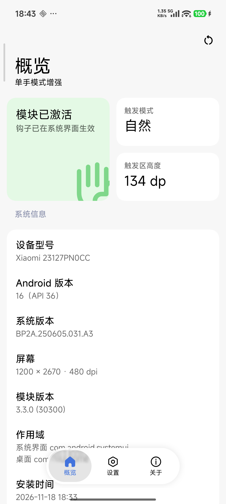
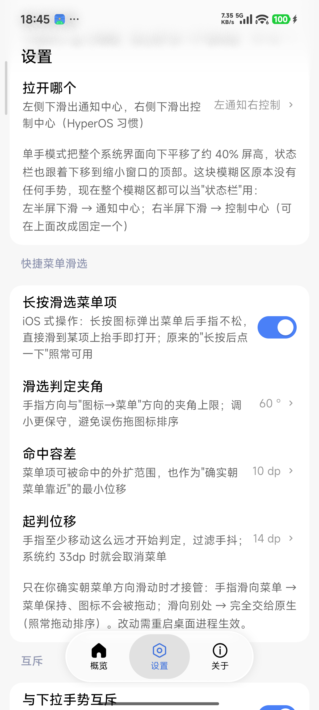
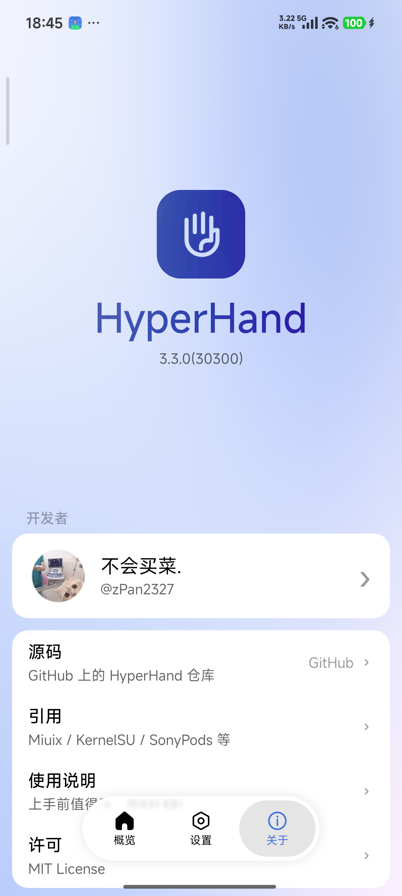
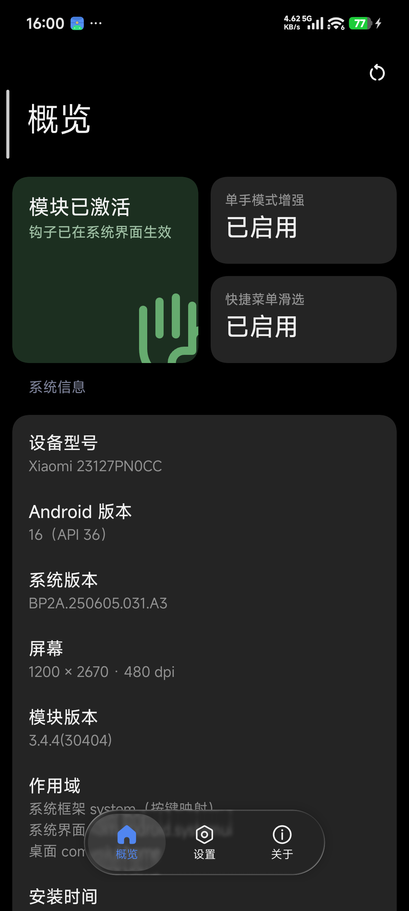
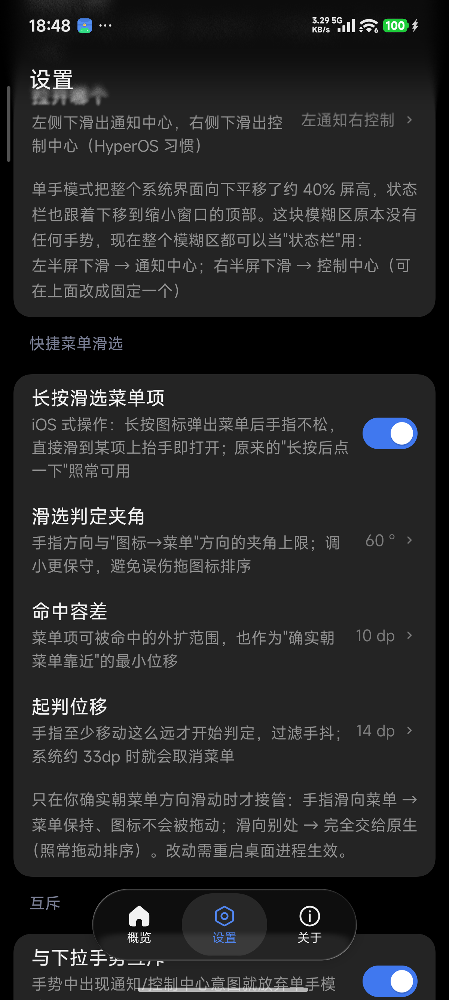
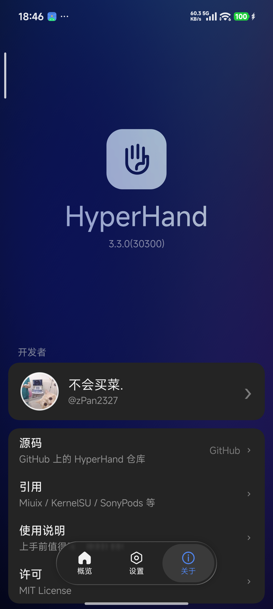

<div align="center">

# HyperHand

**HyperOS 上的手势增强模块：音量键映射、底部下滑单手模式、桌面菜单滑选。**

在小米 14 / HyperOS 3（Android 16）上提供三组功能：把音量键映射成媒体/音量动作（3.3.5 起），
底部下滑触发单手模式，长按桌面图标后滑动选中菜单项（3.3.0 起）。
三者都只改触发与交互层，系统原有的动画、布局、窗口行为保持不变。

[](#验证环境)
[](#模块声明与-api-102)
[](#安装)
[](LICENSE)

</div>

---

## 它解决什么问题

- **音量键映射**（3.3.5）：系统音量键只能调音量。这里把短按、长按、双击、连按分别映射到切歌、播放暂停、音量等动作，按规则生效，可限定应用与锁屏状态。
- **快捷菜单滑选**（3.3.0）：系统长按图标后必须松手再点菜单项；这里改成不松手直接滑到目标项、抬手选中。
- **单手模式**：系统入口是底部 25dp 的窄条，高度写死在 `NavStubView.getHotSpaceHeight()` 里，不是资源、也没有设置开关。模块把触发区放大并开放调节，同时处理它和下拉通知/控制中心的手势冲突。

三组功能各自独立，设置页里一个功能一张卡，关掉总开关就收起该卡的全部设置，参数不会丢。

单手模式的设计细节见下文，滑选的真机验证见 [docs/桌面快捷菜单滑动选择.md](docs/桌面快捷菜单滑动选择.md)，
按键映射的规则结构与引擎实现见 [docs/智能按键映射-Phase4-真机验证报告.md](docs/智能按键映射-Phase4-真机验证报告.md)。

## 智能按键映射（3.3.5）

设置页「按键映射」→「规则与按键」进入独立页面。一条规则由三部分组成：

1. **触发方式**：音量上/下 + 短按、长按、双击、连按（长按阈值、双击间隔可在规则里调）。
2. **状态条件**：可选前台应用、是否在播放、是否锁屏、屏幕方向等，多个条件按「全部满足 / 任一满足」组合。
3. **动作**：下一首、上一首、播放暂停、音量加/减等。

规则之间按优先级匹配，但四种按压方式**分别找规则**：短按在 A 规则、长按在 B 规则也能各自生效。
高优先级规则里把某个动作显式设成「保持原功能」时，它仍然占住这个位置，低优先级规则不会顶上来。
四种动作全是「保持原功能」时整条按键事件直接透传，系统音量照常响应。

实现要点：

- 拦截点是 `PhoneWindowManager#interceptKeyBeforeQueueing(KeyEvent, int)`，拦截系统_server 作用域。
- 按住不放的判定由模块自己计时。`interceptKeyBeforeQueueing` 收不到 repeat 事件，系统不会把长按重复发到这里。
- 短按要等双击窗口关闭才落定，避免「想双击却先触发了短按」。
- 应用列表存磁盘快照并后台刷新，图标懒加载；选择应用时可把已选应用置顶，列表会标注推荐应用。
- 规则通过 `Settings.Global` 传给 system_server，带版本号和 CRC32 校验；解析失败时沿用最后一份有效配置，不会让按键失灵。

跨进程配置需要 `WRITE_SECURE_SETTINGS`。App 首次写 `Settings.Global` 前会尝试用 root 给自己授权
（`pm grant`），一次授权后写入不再需要 root。

## 特性

- **扩大触发区**：底部 56dp（默认）/ 可配到任意高度，居中宽度可裁切 + 左右偏置（照顾单手落指习惯）。
- **双路径识别**（2.2 新增）：
  - *快甩路径*：短距离 + 峰值速度达标即触发，快甩不漏判；
  - *慢拉路径*：长距离 + 平均速度达标 + 轨迹稳定也触发，**不需要刻意甩**。
  两条路径各算置信度取较大值，分项用连续函数而非硬阈值，没有"差 1px 就不响应"的悬崖。
- **三种模式**：自然（iPhone 式）/ 灵敏 / 防误触，一键换一组推荐阈值。
- **稳健的速度估计**（2.2 新增）：用 `MotionEvent` 的**历史采样** + 60ms 滑动窗口算速度，
  不再拿相邻两帧的瞬时速度当峰值 —— 120Hz 屏单帧只有 6~8ms，逐帧求导会被量化噪声炸出假峰值。
- **意图判别（三道闸门）**：与桌面"下拉打开通知/控制中心"手势互斥，不会出现"想进单手却开了通知中心"。
- **手势调试**：开启调试后，最近的判定结果、分项指标与未触发原因可直接在设置页查看。
- **与原生完全一致**：调用的是系统自己的 `OneHandedController.startOneHanded()`；点击上方退出、胶囊条上滑退出、超时退出、无障碍播报全部保留。
- **零窗口侵入**：只在已有的输入监视通道上观察，不消费事件 —— 上滑回桌面、上滑悬停进最近任务、左右边缘返回、点击延迟、长按全都不受影响。
- **无需 root 改系统**：不修改 `/system`、不替换任何 APK，OTA 不受影响；停用模块即恢复原状。
- **参数可在手机上直接调**：自带配置界面，写入 `Settings.Global`，改动后自动保存、立即生效。
- **模糊壁纸背景（2.4 → 2.6）**：单手模式上方默认那块纯米白遮罩，可换成**当前壁纸的高斯模糊**（半径、压暗均可调），视觉上更接近 iOS 的 Reachability；壁纸或深浅色变化会自动重算。模糊图由**应用窗口下面那层**提供、盖在上面的 tutorial 窗口保持透明，所以缩小动画期间不会提前在应用上方蒙一层灰；入场第一帧就是模糊图，系统中途也改不动它。
- **落点判定（2.8）**：抬手点必须**拖到屏幕最底边**才算单手模式，没到底就当成页面滑动放行 —— 桌面抽屉、可滚动列表不再被抢手势。贴底路径不再看速度/置信度，只要求向下 6dp、时长 50ms，所以既更灵敏也更不容易误触。带宽（默认 24dp）可在设置页调。
- **动画可调速（2.7）**：缩小 / 恢复动画的时长与曲线都能在设置页调。系统原生是 600ms + ease-out expo 曲线，**前 10% 时间就走完 50% 位移**，所以显得"傻快"；模块提供 5 档曲线（原生 / 舒缓 / 柔和 / **标准** / 迅捷）和 0.60~2.00 倍时长，只改单手模式这一条动画，不碰系统窗口动画。这两项**改完即时生效**，设置页会显示系统原生值、当前生效值和上次实测耗时。
- **模糊区下拉（2.9）**：单手模式下，上半屏那片模糊区**任意位置往下滑**就能拉出通知中心（左半屏）或控制中心（右半屏），拉下来的同时**自动退出单手模式**，不用再手动点一下退出。不需要记"虚拟顶部"在哪 —— 单手模式把整个界面向下平移了约 40% 屏高，状态栏也跟着搬走了，这块模糊区原本完全没有手势。虚拟顶部那条状态栏下拉、以及在缩小窗口中间内容区下拉（桌面/应用把事件转发给系统展开面板）同样会退出单手模式，四条路径行为一致。未达触发距离（默认 36dp）时仍然走原生的"点一下退出"，互不干扰。
- **一键重启两个作用域（2.4）**：设置页底部可直接结束 SystemUI 与桌面进程让钩子重新注入，省掉重启手机；有 root 走 `killall`，没有 root 时自动退回让 SystemUI 自行重启（persistent 进程会被系统拉起）。
- **桌面快捷菜单 iOS 式滑选（3.3.0）**：长按图标弹菜单后手指不离开，滑到菜单项抬手即选中；菜单在上方或下方都可用，图标不会跟着动或漂移，命中项是浅灰按压态 + 系统「设置」边界反弹同款震动。菜单开着点图标可直接打开 App，点菜单项不会误触底下的图标。实现与真机验证细节见 [`docs/桌面快捷菜单滑动选择.md`](docs/桌面快捷菜单滑动选择.md)。

## 界面

设置页分三组：按键映射、单手模式增强、快捷菜单滑选，每组一张卡。卡片第一行是开关，
关掉后这张卡下面的设置项收起，其他两组不受影响。

单手模式参数较多，默认只显示常用的几项（触发模式、模糊壁纸背景、下滑展开面板），
其余识别阈值、触发区尺寸、动效曲线、面板手势与互斥、算法常量都收在「显示高级参数」里，
打开开关才展开。

视觉上参照 [SonyPods](https://github.com/Mercury000/SonyPods) 的版式、
[Miuix](https://github.com/compose-miuix-ui/miuix) 的组件规格和
[AndroidLiquidGlass](https://github.com/Kyant0/AndroidLiquidGlass) 的液态玻璃结构：
折叠式大标题栏（title1 32sp → 收起后 title3 20sp）、`#F7F7F7` 底色、
16dp 圆角白卡、14sp 加粗分段标题、17sp 行标题 + 14sp 摘要，强调色 `#3482FF`，深色模式跟随系统。
数值直接显示在行右侧，点开用滑杆改，改动即时保存。

浅色（默认）：

| 概览 | 快捷菜单滑选 | 关于 |
|---|---|---|
|  |  |  |

<details><summary>深色模式</summary>

| 概览 | 快捷菜单滑选 | 关于 |
|---|---|---|
|  |  |  |

</details>

设计稿来源与逐条 token 对照见 [docs/设计稿对照.md](docs/设计稿对照.md)。设置页与主页是原生 View，
智能按键映射的各页面用 Compose + Miuix，两者都通过原生 Activity 承载。

## 验证环境

| 项目 | 值 |
|---|---|
| 机型 | Xiaomi 14（`houji`，23127PN0CC） |
| 系统 | HyperOS 3 `OS3.0.305.0.WNCCNXM`，Android 16（SDK 36） |
| 导航 | 手势导航（`navigation_mode=2`），1200×2670 @480dpi |
| Root | KernelSU + Zygisk（NeoZygisk） |
| 注入 | Vector 2.2.1（LSPosed fork，包名 `org.lsposed.manager`） |
| 模块 | libxposed 现代 API 102（`module.prop` 里 `minApiVersion=102`） |

> 本模块**只在小米 14（houji / Android 16 / HyperOS 3）上实测过**。其他小米 / 红米系机型
> 理论上都可以使用，但不同机型的系统类名或方法名可能不同，钩子会静默失效（不会崩溃），
> 请自行测试。详见[已知限制](#已知限制)。

## 原理

原生链路（手势导航）：

```
底部 76px 下滑 → com.miui.home 的 NavStubView（GestureStubHome 窗口）
  → OneHandedModeInputConsumer → MiuiSystemUiProxy.startOneHandedMode()
  → SystemUI / WMShell: OneHandedController.startOneHanded()
  → OneHandedDisplayAreaOrganizer.scheduleOffset(0, height * 0.4)
```

本模块的做法是**旁路**：单手模式启用时，SystemUI 本来就常驻一条 `[Gesture Monitor] onehanded-touch` 输入监视通道（只观察、不消费）。在这条通道上做判定，命中后调用同一个 `startOneHanded()`。

与通知/控制中心的三道闸门：

| 闸门 | 位置 | 做法 |
|---|---|---|
| ① 区域归属 | 桌面进程 | 钩 `StatusBarSwipeController.canInterceptTouch()`，DOWN 落在触发区内 → 让桌面下拉手势让位 |
| ② 抬手 + 综合评分 | SystemUI | 触发推迟到 `ACTION_UP`，按"双路径置信度"判定（见下节） |
| ③ 下拉信号互斥 | SystemUI | 监听 `LauncherProxyService$1.onTransact(case 10)` / `ShadeViewController.startInputFocusTransfer()` / `ControlCenterEventHandlerImpl.handleExpandEvent()`，手势期间出现即放弃单人模式 |

完整的调用链、反编译证据、参数含义与实测日志见 **[docs/单手模式增强.md](docs/单手模式增强.md)**。

## 识别算法（2.2）

### 采样：连历史帧一起收

`MotionEvent` 一个事件可能带多个历史采样（`getHistorySize()`），120Hz 屏一帧只有 6~8ms，
单帧位移常常不到 10px。2.1 用"相邻两帧位移 / 时间差"求速度，量化噪声能到 ±1000 px/s；
2.2 把历史采样全部入队（抽稀后最多 192 点），以 `ACTION_DOWN` 为零点存相对时间戳（float 存绝对
`uptimeMillis` 会丢精度）。

### 速度：滑动窗口取两端

```
v(t) = (y(t) - y(t-W)) / (t - (t-W)) * 1000 / density     [dp/s]，W = oh_tuner_velocity_window_ms
```

窗口 60ms 相当于 7 帧左右，噪声被压掉一个数量级。由它得到三个量：

| 量 | 含义 | 用途 |
|---|---|---|
| `vpeak` | 窗口速度最大值（只取向下分量） | 快甩路径 |
| `vavg` | 整段位移 / 整段时长 | 慢拉路径 |
| `v_end` | 抬手前最后一个窗口的速度 | 识别"拉下去又推回来" |

超过 `oh_tuner_max_velocity`（默认 4000 dp/s）的估计值按上限截断，不让单帧抖动造出假峰值。

### 判定：两条路径，各自算置信度

| | 快甩路径 A | 慢拉路径 B |
|---|---|---|
| 距离 | ≥ `min_dy_dp`（12dp） | ≥ `slow_dy_dp`（28dp） |
| 速度 | `vpeak` ≥ `min_velocity_dp_s`（60dp/s） | `vavg` ≥ `min_avg_velocity`（35dp/s） |

两条路径的距离/速度分项各自过 `score()`（门限处满分，跌到门限 45% 时为 0），
再和方向分、稳定分取 `min()` 得到置信度，最后 `conf = max(confA, confB)`，`conf ≥ min_confidence` 即触发。
因为是连续函数，不存在"差 1px 完全不响应"的悬崖；因为取了 max，短距离快甩和长距离慢拉都能命中。

硬性闸门仍然保留（命中即放弃，不参与评分）：方向必须向下、`|dx|/dy ≤ max_slope`、
净位移/路程 ≥ `min_monotonic`、抬手前没有明显反向、时长与冷却、以及三道互斥闸门。

### 自适应

`oh_tuner_enable_adaptive_threshold=1` 时：300ms 内完成的手势最多 +0.06 置信度，
700ms 以上最多 -0.06；"拉下去按住不动再抬手"额外 ×0.75。

### 同一次触摸只触发一次

`ACTION_UP` 判定通过后置 `sTriggered`，同一段触摸后续的 MOVE/UP 不再判定；
`ACTION_CANCEL` / 第二根手指按下都会立刻放弃本次轨迹，不会出现"两次缩小动画"。

## 模块声明与 API 102

模块用的是 **libxposed 现代 API（API 102）**，不再是 `assets/xposed_init` + `xposedminversion=82` 那套 legacy 形态。
现代 API 把"模块是什么"从 manifest 的 meta-data 挪到了 APK 里的三个文件，好处是作用域可以静态声明：

| 文件 | 作用 | 内容 |
|---|---|---|
| `META-INF/xposed/java_init.list` | 入口类 | `io.github.zpan2327.hyperhand.HyperHand` |
| `META-INF/xposed/scope.list` | **静态作用域** | `com.android.systemui` / `com.miui.home` |
| `META-INF/xposed/module.prop` | 版本与行为 | `minApiVersion=102`、`targetApiVersion=102`、`staticScope=true` |

- **静态作用域**：`staticScope=true` 时管理器不允许用户加挂其它应用，装到别的机型上也不会因为
  "勾错作用域"去 hook 无关进程。
- **模块名与简介**：直接取 `res/values/strings.xml` 里的 `app_name` / `app_description`
  （即 `android:label` / `android:description`）。
- **钩子写法**：现代 API 是拦截器链（`Hooker#intercept(chain)`），`Hooks.java` 把
  `findClass` / `hookMethods` / `hookConstructors` / `call` 这些 legacy 习惯封装回来了；
  2.2 起判定算法独立到 `Recognizer.java`，`HyperHand.java` 只负责钩子、前置闸门与触发。
- **框架要求**：需要实现 API 102 的框架 —— Vector 2.x 或新版 LSPosed。
  LSPosed 1.9.x 只到 API 101，会把本模块当成"需要更新框架"而跳过。

## 安装

### 方式一：直接装 release APK

> **从 1.x 升级需先卸载旧包**：包名已从 `com.onehandtuner` 改为 `io.github.zpan2327.hyperhand`，
> 两者是彼此独立的应用。`adb uninstall com.onehandtuner`（或手动卸载「单手模式增强」）后再装。

1. 从 [Releases](../../releases) 下载 `HyperHand.apk` 并安装。
2. 在 **Vector / LSPosed** 里启用 **HyperHand** 即可。作用域已在 APK 里**静态声明**
   （`com.android.systemui` + `com.miui.home`），不需要手动勾选，也无法挂到别的应用上。
3. 重启两个进程让模块加载：

```bash
adb shell am crash com.miui.home
adb shell am crash com.android.systemui
# 注：am force-stop 对 SystemUI 无效（pid 不变），必须用 am crash
```

4. 验证钩子已注入：

```bash
adb logcat -d -s HyperHand
# SystemUI: attached to SystemUI / OneHandedTouchHandler hooked / OneHandedController captured
#           LauncherProxyService$1 hooked / NotificationPanelViewController hooked / ControlCenterEventHandlerImpl hooked
# 桌面:     attached to Launcher / StatusBarSwipeController hooked (zone ownership)
```

### 方式二：自己构建

见[构建](#构建)。

## 使用

- **配按键映射**：「按键映射」卡打开总开关 →「规则与按键」→ 新建规则，选按键、按压方式和动作，
  需要时加应用/锁屏等条件。保存后在设置页或锁屏界面按音量键即可验证。
  测长按要按住 500ms 以上（`input keyevent --longpress` 在部分 ROM 只按 300ms，测不出来）。
- **进单手模式**：在底部 56dp（默认）范围内往下滑即可，慢拉和快甩两条路径都认。
- **慢拖不触发**：慢慢往下拖且距离很短不会进单手模式（方便在底部区域滚动）；
  只有"拉得足够长 + 轨迹干净"的慢滑才走慢拉路径。
- **通知/控制中心**：从触发区**上方**下拉，或从顶部状态栏下拉。
- **退出**：点一下缩小区域上方 / 在胶囊条上上滑 / 等待超时 —— 全部是原生行为。
- **调参**：打开「HyperHand」App 改数值 → 自动保存、立即生效（无需点保存、无需重启、无需 root）。
- **看判定过程**：「调试」卡片点「最近手势」，可直接看到上一次的位移/速度/置信度与未触发原因。
- **背景改成模糊壁纸**：「外观」卡片打开「模糊壁纸背景」，半径/压暗可调；点「调试 → 预览遮罩」可以立刻进入一次单手模式看效果。
- **改了模块版本后**：设置页底部点「重启两个作用域」（有 root 会直接结束进程，没有 root 则让 SystemUI 自行重启），或手动重启手机，让新钩子注入。

## 可配置参数

全部存于 `Settings.Global`，前缀 `oh_tuner_`，App 界面可改，也可用 `adb`：

```bash
adb shell am broadcast -a io.github.zpan2327.hyperhand.action.SET --es oh_tuner_min_velocity_dp_s 120
```

**单位约定**：距离用 `dp`，速度用 `dp/s`（与屏幕密度无关）。旧版的 `oh_tuner_min_velocity_px_s` 仍然可读，
首次加载时会按 density 折算写入 `oh_tuner_min_velocity_dp_s`，之后以新键为准。

| 键 | 含义 | 默认 |
|---|---|---|
| `oh_tuner_enabled` | 总开关 | `1` |
| `oh_tuner_monitor_enabled` | 启用扩展触发（旁路监视器） | `1` |
| `oh_tuner_recognition_mode` | 识别模式：`0` 自然 / `1` 灵敏 / `2` 防误触 | `0` |
| `oh_tuner_zone_dp` | 底部触发区高度（dp，比例模式关闭时生效） | `72` |
| `oh_tuner_zone_ratio_mode` | 触发区按屏幕高度比例算，覆盖到 dock 栏上方 | `1` |
| `oh_tuner_zone_ratio` | 比例模式的屏幕占比（0.15 ≈ dock 上沿） | `0.15` |
| `oh_tuner_width_ratio` | 有效宽度占比，`0.2`~`1.0` | `1.0` |
| `oh_tuner_zone_bias` | 有效区域中心左右偏移，`-0.4`~`0.4`（正数右移） | `0` |
| `oh_tuner_min_dy_dp` | **快甩路径**最小下滑距离（dp） | 随模式：`12` / `8` / `18` |
| `oh_tuner_min_velocity_dp_s` | **快甩路径**峰值速度门限（dp/s），`0` = 关掉速度只看距离 | 随模式：`60` / `40` / `120` |
| `oh_tuner_min_velocity_px_s` | 旧键（px/s），仅作兼容读取 | — |
| `oh_tuner_slow_enabled` | 启用**慢拉路径** | `1` |
| `oh_tuner_slow_dy_dp` | 慢拉路径所需距离（dp） | 随模式：`28` / `20` / `44` |
| `oh_tuner_min_avg_velocity` | 慢拉路径平均速度门限（dp/s） | 随模式：`35` / `25` / `70` |
| `oh_tuner_min_confidence` | 置信度门限 `0.05`~`1.0`，越低越灵敏 | 随模式：`0.50` / `0.42` / `0.60` |
| `oh_tuner_enable_adaptive_threshold` | 自适应阈值：干脆的快手势略放宽，拖沓的长手势略收紧 | `1` |
| `oh_tuner_velocity_window_ms` | 速度估计的滑动窗口（ms） | `60` |
| `oh_tuner_max_velocity` | 速度上限（dp/s），超出按噪声截断 | `4000` |
| `oh_tuner_min_monotonic` | 轨迹稳定度下限（净位移/路程） | `0.78` |
| `oh_tuner_max_slope` | 最大横向偏移比 `abs(dx)/dy` | `1.2` |
| `oh_tuner_cooldown_ms` | 触发冷却（毫秒） | `500` |
| `oh_tuner_max_duration_ms` | 最长手势时长，`0` = 不限 | `0` |
| `oh_tuner_shade_guard` | 与下拉通知/控制中心互斥（闸门③） | `1` |
| `oh_tuner_claim_zone` | 底部区域归单手模式：桌面下拉在区内**直接不展开通知/控制中心**（闸门①） | `1` |
| `oh_tuner_launcher_hot_dp` | 覆盖原生胶囊条窗口高度，`0` = 不改（会吞底部内容的长按，默认关） | `0` |
| `oh_tuner_debug` | 输出调试日志 + 记录最近手势 | `1` |
| `oh_tuner_blur_bg` | 单手模式上方的遮罩用**模糊壁纸**（`0` = 系统原生米白） | `1` |
| `oh_tuner_blur_radius` | 模糊半径（dp），`0` 近似壁纸原图 | `24` |
| `oh_tuner_blur_dim` | 模糊壁纸的压暗程度（%），拉开与缩小窗口的层次 | `12` |
| `oh_tuner_anim_scale` | 缩小/恢复动画时长倍率（`1.00` = 系统原生 600ms） | `1.10` |
| `oh_tuner_anim_curve` | 动画曲线：`0` 原生 / `1` 舒缓 / `2` 柔和 / `3` 标准 / `4` 迅捷 | `3` |
| `oh_tuner_anim_info` | 只读，SystemUI 回写"系统原生值 + 当前值 + 上次实测"，设置页直接显示 | —— |
| `oh_tuner_end_boost` | 贴底才算单手模式（`0` 回到纯速度/距离判定） | `1` |
| `oh_tuner_end_zone_dp` | 抬手点距屏幕底边小于该值算"到底" | `32` |
| `oh_tuner_top_shade` | 单手模式下模糊区下滑展开通知/控制中心 | `1` |
| —— | 只要面板被拉出来（任意入口）都会退出单手模式，见 docs §10.7 | —— |
| `oh_tuner_top_shade_dy_dp` | 触发所需的向下距离（dp） | `36` |
| `oh_tuner_top_shade_side` | 拉开哪个：`0` 左通知右控制 / `1` 总是通知 / `2` 总是控制 | `0` |

> "随模式"的三组值：自然 `0` / 灵敏 `1` / 防误触 `2`。设置页里点某一项改了值，这一项就变成显式配置，
> 不再跟随模式；点「恢复默认参数」会回到自然模式的推荐值。

**调参建议**

- 还是觉得要甩：模式选「灵敏」，或把 `min_velocity_dp_s` 降到 40~60、`min_confidence` 降到 0.40。
- 误触偏多：模式选「防误触」，或把 `min_confidence` 提到 0.62~0.70、`min_dy_dp` 提到 16~22。
- 慢滑不灵：确认 `slow_enabled=1`，把 `slow_dy_dp` 降到 24、`min_avg_velocity` 降到 30。
- 局部抖动误判（个别 app 里报点很噪）：把 `velocity_window_ms` 提到 80~100。
- 模糊背景没生效：确认 `blur_bg=1`；**动态壁纸**取不到位图，会保持系统米白。改完参数后要看效果，用「调试 → 预览遮罩」最快。
- 触发区还想更大：加大 `zone_dp`（实机用 70dp 也验证过）。
- 想在底部下拉开通知中心：把 `claim_zone` 设为 `0`。开着时底部区域**完全不展开**通知/控制中心
  （桌面转发的事件在 SystemUI 的 binder 入口就被吞掉），想拉通知栏请从屏幕上部下拉。

## 构建

依赖：JDK 17、Android SDK（`compileSdk 37`）。构建由 Gradle 驱动，两个模块：

| 模块 | 内容 |
|---|---|
| `:module` | 模块本体（纯 Java）+ `src/main/res` / `META-INF/xposed` |
| `:glass` | 液态玻璃底栏（Kotlin / Compose），从 [LiquidDemo](https://github.com/zPan2327/LiquidDemo) 迁入 |

**Windows**

```powershell
pwsh -File module/build.ps1
```

**Linux / macOS**

```bash
./module/build.sh
```

上面两个脚本只是薄壳，内部转调 `./gradlew :module:assembleHyperHand`；直接跑 Gradle 也可以。
SDK 路径用 `ANDROID_HOME` / `ANDROID_SDK_ROOT`（或写进 `local.properties`），JDK 用 `JAVA_HOME`。
签名密钥固定放在 `module/signing/hyperhand.keystore`（已 gitignore，首次构建自动生成）—— 保留它才能持续用 `adb install -r` 覆盖升级。
产物：`module/out/HyperHand.apk`。`minSdk` 是 **33**（miuix-blur 的硬性要求，比原来的 31 高一档，实际只放弃 Android 12）。

CI 使用 runner 预装的 Android SDK，不需要额外安装。若想让 CI 产物和本地构建同签名，在仓库 **Settings → Secrets and variables → Actions** 里加一个 `ANDROID_KEYSTORE_B64`，值为本地 keystore 的 base64：

```powershell
[Convert]::ToBase64String([IO.File]::ReadAllBytes("module\signing\hyperhand.keystore")) | Set-Clipboard
```

## 目录结构

```
.
├── README.md
├── CHANGELOG.md
├── LICENSE
├── docs/
│   ├── 单手模式增强.md      # 完整技术文档：调查结论 / 调用链 / 方案比较 / 实测日志 / 回滚
│   ├── 液态玻璃底栏.md      # Compose 底栏的接入结构 + 迁移踩坑与改法
│   ├── 设计稿对照.md        # 设置界面的 Miuix / HyperOS token 对照
│   └── screenshots/         # 界面的浅色 / 深色 / 对话框截图
├── glass/src/main/kotlin/       # 液态玻璃底栏（Kotlin / Compose）
│   ├── io/github/zpan2327/liquidglass/   #   渲染实现（AGSL 折射 / 模糊 / 增艳 / 阻尼拖拽）
│   └── io/github/zpan2327/hyperhand/glass/  #  包成 Android View 的桥接
├── module/
│   ├── src/main/AndroidManifest.xml
│   ├── src/main/resources/META-INF/xposed/   # libxposed 现代 API 的模块声明
│   │   ├── java_init.list      #   入口类：io.github.zpan2327.hyperhand.HyperHand
│   │   ├── scope.list          #   静态作用域：systemui + miui.home
│   │   └── module.prop         #   minApiVersion / targetApiVersion / staticScope
│   ├── src/main/res/values/strings.xml  # 模块名与简介（android:label / android:description）
│   ├── src/main/java/io/github/zpan2327/hyperhand/
│   │   ├── HyperHand.java      # 钩子主体（SystemUI 前置闸门 + 触发 + 结果发布 / 桌面侧闸门）
│   │   ├── Recognizer.java     # 手势识别核心：历史采样 / 分窗速度 / 双路径评分
│   │   ├── Hooks.java          # libxposed API 102 的兼容层（findClass / hookAll / call）
│   │   ├── Cfg.java            # 参数读写 + 模式预设 + 旧配置迁移
│   │   ├── MainActivity.java   # 参数调节界面（分组 / 高级折叠 / 手势调试）
│   │   └── Ui.java             # Miuix 风格组件：卡片 / 行 / 开关 / 按钮 / 数值与单选对话框
│   ├── libs/api-102.jar        # 编译期 libxposed API stub（compileOnly）
│   ├── build.gradle.kts
│   ├── build.ps1 / build.sh    # Gradle 薄壳，保留原文件名与产物路径
│   └── out/                    # 构建产物（gitignore）
└── .github/workflows/build.yml # CI：构建 + 上传 artifact + 同步官方模块仓库
```

## 提交到官方模块仓库

LSPosed 的模块列表来自 GitHub 组织 [`Xposed-Modules-Repo`](https://github.com/Xposed-Modules-Repo)，
每个模块一个仓库。收录要求（[官方说明](https://github.com/Xposed-Modules-Repo/.github)）：

1. 仓库名 **必须等于模块包名** → `io.github.zpan2327.hyperhand`
2. 仓库 description 非空，作为模块显示名 → `HyperHand`
3. 至少有一个 release，且 release 的 tag 必须是 `VersionCode-VersionName` 格式 → `20000-2.0.0`
4. release 里至少有一个 `.apk` 资源

流程：

1. 打开 <https://modules.lsposed.org/submission>，用 GitHub 登录并提交 `io.github.zpan2327.hyperhand`；
   机器人会建好仓库并把维护权限给你。
2. 在本仓库的 Secrets 里配置 `MODULE_REPO_TOKEN`：一个对 `Xposed-Modules-Repo/io.github.zpan2327.hyperhand`
   有写权限的 PAT（classic token，勾 `repo`）。
3. 之后每次打 `v*` tag，CI 除了在本仓库发 Release，还会把同一个 APK 以
   `版本号-版本名` 的 tag 同步到模块仓库（`.github/workflows/build.yml` 里的
   `Publish to Xposed-Modules-Repo` 步骤；没配 token 时自动跳过）。

> 维护者注意：签名要保持一致——仓库里的 `module/signing/hyperhand.keystore` 与
> Secret `ANDROID_KEYSTORE_B64` 必须是同一把（当前指纹 `912FA6BF…6A7A`）；发版只走
> CI 打 tag 这一条路，不要同时用本地脚本上传 APK，否则会竞态覆盖、导致用户无法覆盖安装。

> 详细步骤、密钥同步方法与排错见 [docs/发布到模块仓库.md](docs/发布到模块仓库.md)。

## 常见问题

**Q：模块装了但完全没反应？**
按顺序排查：① 框架是否支持 **libxposed API 102**（Vector 2.x / 新版 LSPosed 才有，旧 LSPosed 1.9.x 只到 101，会直接忽略本模块）；② Vector 里模块是否启用；③ 是否 `am crash` 重启过 SystemUI；④ `adb logcat -s HyperHand` 是否能看到 `attached to SystemUI`；⑤ `one_handed_mode_enabled` 是否为 1。

**Q：作用域在哪里选？**
不用选。`scope.list` + `module.prop` 的 `staticScope=true` 已经把作用域静态声明成「系统界面 + 小米桌面」，
管理器里会显示为不可编辑；装到别的机型上也不会被误挂到其它应用。

**Q：想触发单手，却开了通知中心？**
说明闸门①没生效（多半是没重启桌面进程）。`adb shell am crash com.miui.home` 即可。

**Q：慢滑也触发了 / 想要更难触发？**
换「防误触」模式，或把 `oh_tuner_min_confidence` 调到 0.62~0.70、`oh_tuner_min_dy_dp` 调到 16~22；
只想禁掉慢拉路径，把 `oh_tuner_slow_enabled` 设为 `0`。

**Q：快甩偶尔不触发？**
先看「调试 → 最近手势」里那次判定的 `vpeak` 与 `conf`。若 `vpeak` 明显低于 `min_velocity_dp_s`，
把它调到略低于实测值；若是 `SKIP(too_short)`，说明位移不够，把 `min_dy_dp` 调小。

**Q：从 2.1 升级，参数会丢吗？**
不会。所有旧键名与语义都保留；`oh_tuner_min_velocity_px_s`（px/s）会在首次加载时按 density
折算写入 `oh_tuner_min_velocity_dp_s`（dp/s），之后以新键为准。旧键若显式设过，升级后的灵敏度与原来一致。

**Q：为什么模式切了但手感没变？**
模式只提供"推荐值"。如果某一项之前被显式保存过，它就是显式配置，不再跟随模式；
点「恢复默认参数」会整体回到自然模式的推荐值。

**Q：会不会影响上滑回桌面、最近任务、返回手势？**
不会。监视通道只观察不消费，且模块不修改任何窗口的 touchable region。

### 液态玻璃底栏

底栏从 3.0.2-beta.2 起由 Compose 组件绘制（渲染实现来自
[LiquidDemo](https://github.com/zPan2327/LiquidDemo)，复刻自 miuix / AndroidLiquidGlass）。
完整的问题清单与改法见 [docs/液态玻璃底栏.md](docs/液态玻璃底栏.md)，这里只列最常被问到的：

**Q：页面滚动时玻璃不动，或者「先滑一下底栏、再滚页面」，选中项的背景就定格了？**
两个不同原因：① 普通 `View` 滚动不会让 Compose 的绘制节点失效，需要 `redrawSignal` 逐帧 +1；
② 指示器采样用的录制层只在「录制源节点重画」时才重新录，所以信号必须同时接给
**容器、隐藏图标行、指示器**三处。3.0.2-beta.2 已修。

**Q：玻璃里的内容比实际位置偏上，折射出来的总是上面那一行？**
采样坐标把「层左上角」当成了原点。miuix 在调用 `drawBackdrop` 前做了 `translate(padding / ds)`，
原点其实是**胶囊左上角**。少算一个 padding（40dp ≈ 110px）就会整体上移。已修。

**Q：按下时胶囊圆角冒出黑色楔形？**
折射 + 色散越出了采样层。`LayerBackdrop` 背后是整窗内容，自定义 `ViewBackdrop` 只有本层，
越界即透明（黑）。把 `effects` 的 `padding` 抬到 40dp 即可。已修。

**Q：底栏有点卡？**
`ViewBackdrop` 每帧要把页面重画进 Bitmap。已改成只截采样层、半分辨率、容器与指示器共用一张位图；
模拟器滚动 jank 85.7%（真机有硬件 GPU，不背这个锅）。页面里若有大量自绘/视频控件，还会更贵。

**Q：为什么底栏要换成 Compose？**
原来 Java 手写的近似实现没有真折射（只有模糊 + 手搓的 SDF 位移），且 AGSL 在这套工程里维护成本高。
现在是 miuix 的成品管线：真 AGSL 折射、色散、重力高光、阻尼拖拽。

## 已知限制

- 仅手势导航有效；3 键导航的入口不在本模块覆盖范围。
- 横屏、分屏、隐藏提示线（`hide_gesture_line=1`）时系统本身会拒绝 `startOneHanded()`，模块不做绕过。
- 开启闸门①后，**触发区内的桌面下拉不再打开通知/控制中心**（这是刻意的取舍）。
- 折叠屏 / 平板未验证。
- 系统升级后若相关类名/方法名变化，钩子静默失效（日志有 `class not found`），不会崩溃。

## 回滚 / 停用

1. App 里关掉「启用模块」，或 `adb shell am broadcast -a io.github.zpan2327.hyperhand.action.SET --es oh_tuner_enabled 0`；
2. Vector 里停用模块（作用域是静态声明的，无法单独取消）→ `adb shell am crash com.android.systemui`；
3. `adb uninstall io.github.zpan2327.hyperhand`（残留的 `oh_tuner_*` 设置项可忽略，模块不再读取）。

全程未修改任何系统分区文件，无需备份原文件，OTA 不受影响。

## 第三方组件

- `module/lib/api-102.jar`：[libxposed API](https://github.com/libxposed/api) 102（Apache-2.0），仅作编译期 stub，不打包进 APK。

## License

[MIT](LICENSE) © 2026 zPan2327

> 本项目为个人研究性质的系统增强模块，与小米、LSPosed 官方无关；修改系统行为存在风险，请自行评估并做好备份。

如果这个项目对你有用，欢迎点个 **Star** ⭐，这是继续维护的最大动力。
