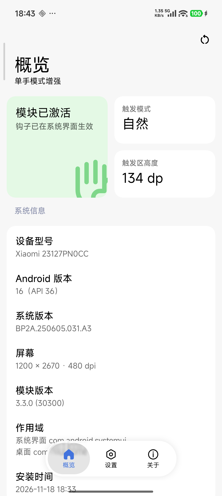
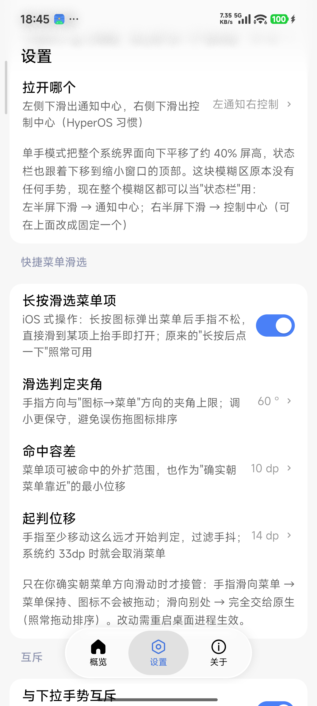
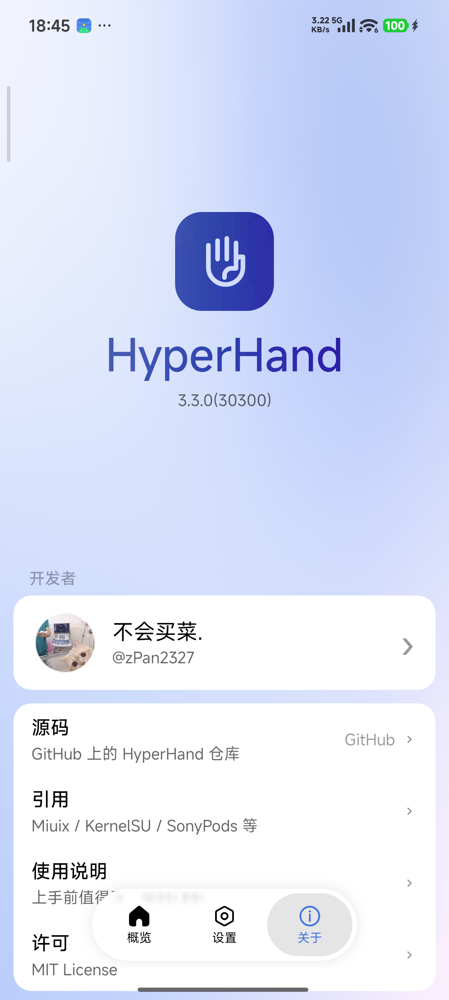
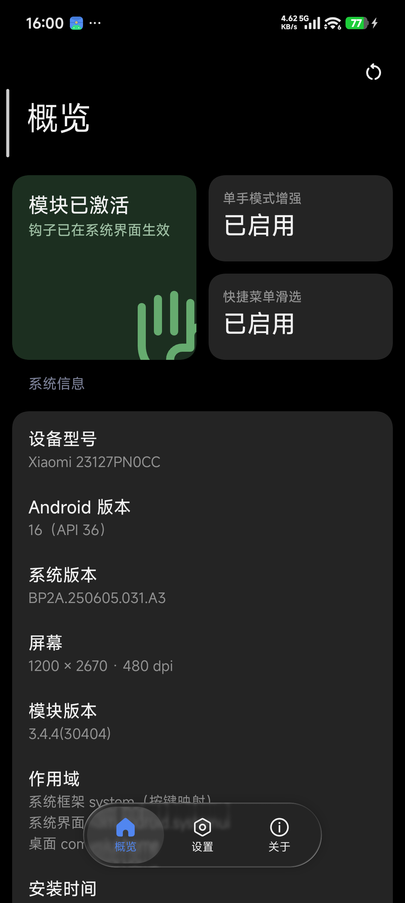
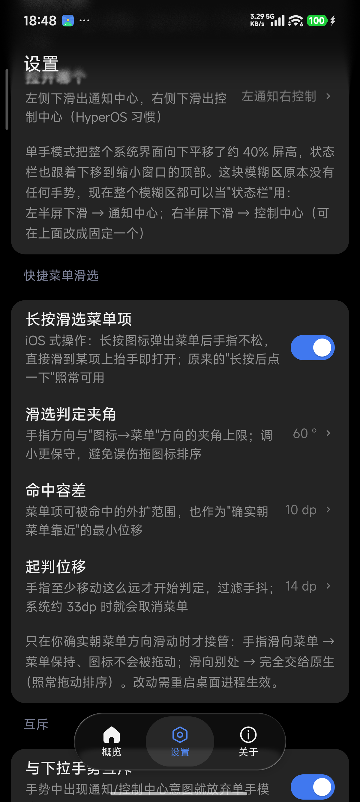
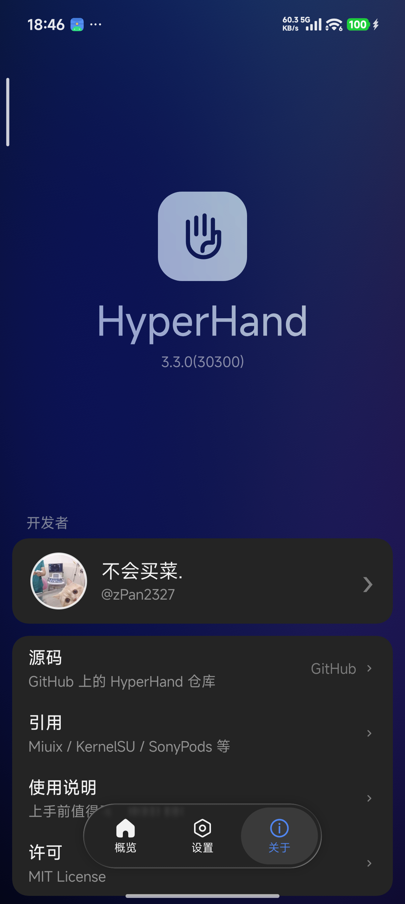

<div align="center">

# HyperHand

**[简体中文](README.md)｜[English](README_EN.md)**

**A gesture-enhancement module for HyperOS: volume-key mapping, swipe-down one-handed mode, and slide-to-select in the launcher menu.**

It provides three features, verified on the Xiaomi 14 / HyperOS 3 (Android 16): remapping the volume keys to media / volume actions (since 3.3.5),
entering one-handed mode by swiping down from the bottom edge, and selecting a launcher menu item by sliding to it without lifting your finger (since 3.3.0).
All three only touch the trigger and interaction layers; the system's own animations, layouts and window behaviour are left unchanged.
The interface language follows the system and supports Simplified Chinese, Traditional Chinese and English (since 3.4.7).

[](#verified-environment)
[](#module-declaration-and-api-102)
[-8A2BE2)](#install)
[](LICENSE)

</div>

---

## What it solves

- **Volume-key mapping** (3.3.5): the volume keys can only change volume. Here a short press, long press, double press or repeated press can be mapped to next track, play / pause, volume and more, applied through rules that can be restricted by app and lock state.
- **Slide-to-select in the launcher menu** (3.3.0): after long-pressing an icon you normally have to lift your finger and tap the item. This changes it to: keep your finger down, slide to the item, lift to select.
- **One-handed mode**: the system entry point is a narrow 25dp strip at the bottom whose height is hard-coded in `NavStubView.getHotSpaceHeight()` — not a resource, and there is no setting for it. The module enlarges the trigger area and makes it adjustable, while also handling the gesture conflict with the pull-down notification / control centre.

The three features are independent. In Settings each feature has one card; turning its master switch off collapses that card's settings without losing any values.

Design details of one-handed mode are below. For slide-select see the on-device verification notes in
[docs/桌面快捷菜单滑动选择.md](docs/桌面快捷菜单滑动选择.md) (Chinese); for the rule structure and engine of key mapping see
[docs/智能按键映射-Phase4-真机验证报告.md](docs/智能按键映射-Phase4-真机验证报告.md) (Chinese).

## Key mapping (3.3.5)

Open **Settings → Key mapping → Rules and keys** to enter its own page. A rule has three parts:

1. **Trigger**: volume up / down plus a press type — short, long, double or repeated (the long-press threshold and double-press interval can be tuned per rule).
2. **State conditions** (optional): foreground app, whether something is playing, whether the screen is locked, and so on, combined with "match all / match any".
3. **Action**: next track, previous track, play / pause, volume up / down and so on.

Rules are matched by priority, but **each press type looks for its rule separately**: a short press can live in rule A while a long press lives in rule B, and both work.
When a higher-priority rule explicitly sets an action to "Keep original", it still holds that slot and a lower-priority rule will not take it over.
If all four press types resolve to "Keep original", the whole key event is passed through untouched and the system volume behaves normally.

Implementation notes:

- The hook point is `PhoneWindowManager#interceptKeyBeforeQueueing(KeyEvent, int)`, in the `system_server` scope.
- Long press is timed by the module itself. `interceptKeyBeforeQueueing` never receives repeat events, so the system will not deliver long-press repeats here.
- A short press only settles after the double-press window closes, so "I meant to double-press but the short press fired first" cannot happen.
- The app list is cached on disk and refreshed in the background, icons load lazily. In the app picker, already-selected apps can be pinned to the top and recommended apps are marked.
- Rules are passed to `system_server` through `Settings.Global` with a version number and a CRC32 check; if parsing fails the last valid configuration is kept, so the keys never stop working.

Writing to `Settings.Global` across processes requires `WRITE_SECURE_SETTINGS`. Before its first write the app tries to grant itself that permission with root
(`pm grant`); after that one-time grant no root is needed.

## Features

- **Larger trigger area**: 56dp at the bottom by default / configurable to any height, with a croppable centred width and a horizontal offset (to suit where your thumb actually lands).
- **Interface language** (3.4.7): Follow system (default) / 简体中文 / 繁體中文 / English, switched at the very bottom of Settings under **Personalization → Language**. Every string in the app is translated; if the system language is none of the three, Simplified Chinese is shown.
- **Two recognition paths** (2.2):
  - *Quick flick*: short distance + peak velocity above the threshold triggers;
  - *Slow drag*: long distance + average velocity above the threshold + a stable path also triggers — **no flick needed**.
  Each path computes a confidence score and the larger one wins. The components are continuous functions rather than hard thresholds, so there is no "1px short and nothing happens" cliff.
- **Three modes**: Natural (iPhone-like) / Sensitive / Anti-mistouch — one tap switches to a set of recommended thresholds.
- **Robust velocity estimation** (2.2): velocity is computed from `MotionEvent` **historical samples** over a 60ms sliding window,
  instead of taking the instantaneous velocity between two adjacent frames — on a 120Hz screen a frame is only 6–8ms, so differentiating frame by frame produces false peaks from quantisation noise.
- **Intent discrimination (three gates)**: mutually exclusive with the launcher's "pull down to open notification / control centre" gesture, so "I wanted one-handed mode but got the notification centre" does not happen.
- **Gesture debugging**: once debugging is on, the latest decision, its component metrics and the reason for rejection can be read directly in Settings.
- **Identical to native**: it calls the system's own `OneHandedController.startOneHanded()`; tap-above-to-exit, swipe-up-on-the-capsule-to-exit, timeout exit and accessibility announcements are all preserved.
- **No window intrusion**: it only observes on an existing input-monitor channel and never consumes events — swipe up for home, swipe up and hold for recents, edge-back, tap latency and long press are all unaffected.
- **No root needed to modify the system**: it does not touch `/system` or replace any APK, OTA is unaffected; disabling the module restores everything.
- **Adjust on the phone**: comes with a configuration UI that writes `Settings.Global`; changes are saved and applied immediately.
- **Blurred-wallpaper backdrop (2.4 → 2.6)**: the plain off-white mask above one-handed mode can be replaced with a **Gaussian blur of the current wallpaper** (radius and dimming adjustable), which looks much closer to iOS Reachability; it is recomputed when the wallpaper or light / dark mode changes. The blur is provided by the layer **underneath the app windows** while the tutorial window on top stays transparent, so no grey film appears over the app during the shrink animation; the blurred image is there from the very first frame and the system cannot change it midway.
- **Drop-point decision (2.8)**: the finger must be **dragged all the way to the bottom edge** to count as one-handed mode; anything that stops short is treated as a page scroll and let through — launcher drawers and scrollable lists are no longer hijacked. The edge path no longer looks at velocity / confidence, requiring only 6dp downward and 50ms, which makes it both more responsive and less prone to false triggers. The tolerance (24dp by default) is adjustable in Settings.
- **Adjustable animation (2.7)**: the duration and curve of the shrink / restore animation can be changed in Settings. The native animation is 600ms with an ease-out expo curve that **covers 50% of the distance in the first 10% of the time**, which is why it feels "dumb-fast"; the module offers five curves (Native / Relaxed / Soft / **Standard** / Quick) and a 0.60–2.00× duration, changing only this one animation and nothing else. Both **apply immediately**, and Settings shows the native value, the value in effect and the last measured duration.
- **Swipe down in the blurred area (2.9)**: in one-handed mode, swiping down **anywhere in the blurred upper half** opens the notification centre (left half) or control centre (right half), and one-handed mode **exits automatically** as the panel comes down — no extra tap to exit. There is no need to remember where the "virtual top" is: one-handed mode shifts the whole interface down by about 40% of the screen height, taking the status bar with it, and that blurred area originally had no gesture at all. Pulling down on the status bar at the virtual top, or pulling down inside the shrunken content area (where the launcher / app forwards the event to the system to expand the panel), also exits one-handed mode — all four paths behave the same way. Below the trigger distance (36dp by default) the native "tap to exit" still applies, and the two do not interfere.
- **Restart scopes in one tap (2.4; system framework added in 3.3.5)**: the button at the top right of Overview restarts the system framework / SystemUI / the launcher so the hooks are re-injected, saving a reboot; with root it uses `killall`, without root it falls back to letting SystemUI restart itself (a persistent process is relaunched by the system).
- **iOS-style slide-to-select in the launcher menu (3.3.0)**: after the long-press menu appears, keep your finger down and slide to an item; lifting selects it. It works whether the menu opens above or below the icon, the icon does not move or drift, and the hit item shows a light-grey pressed state plus the same bounce haptic as the system Settings slider. With the menu open, tapping the icon opens the app directly, and tapping a menu item never triggers the icon underneath. Implementation and on-device verification: [`docs/桌面快捷菜单滑动选择.md`](docs/桌面快捷菜单滑动选择.md) (Chinese).

## Interface

Settings has three groups — key mapping, one-handed mode and slide-select — one card each. The first row of a card is its switch;
turning it off collapses the settings below that card and leaves the other two groups untouched.

One-handed mode has many parameters, so only the common ones are shown by default (trigger mode, blurred wallpaper, swipe to open panel).
The remaining detection thresholds, trigger-area size, animation curve, panel gestures and arbitration, and algorithm constants are tucked away under **Show advanced settings**.

Visually it follows the layout of [SonyPods](https://github.com/Mercury000/SonyPods), the component specs of
[Miuix](https://github.com/compose-miuix-ui/miuix) and the liquid-glass structure of
[AndroidLiquidGlass](https://github.com/Kyant0/AndroidLiquidGlass):
a collapsing large-title bar (title1 32sp → title3 20sp when collapsed), a `#F7F7F7` background,
16dp white cards, 14sp bold section titles, 17sp row titles + 14sp summaries, `#3482FF` accent colour, and dark mode follows the system.
Values are shown on the right of each row; tap to change them with a slider, saved immediately.

Light (default):

| Overview | Slide-select settings | About |
|---|---|---|
|  |  |  |

<details><summary>Dark mode</summary>

| Overview | Slide-select settings | About |
|---|---|---|
|  |  |  |

</details>

For where the design came from and a token-by-token comparison see [docs/设计稿对照.md](docs/设计稿对照.md) (Chinese). Settings and the main screen are native Views;
the key-mapping pages use Compose + Miuix. Both are hosted by native Activities.

## Verified environment

| Item | Value |
|---|---|
| Device | Xiaomi 14 (`houji`, 23127PN0CC) |
| OS | HyperOS 3 `OS3.0.305.0.WNCCNXM`, Android 16 (SDK 36) |
| Navigation | Gesture navigation (`navigation_mode=2`), 1200×2670 @480dpi |
| Root | KernelSU + Zygisk (NeoZygisk) |
| Injection | Vector 2.2.1 (an LSPosed fork, package `org.lsposed.manager`) |
| Module | libxposed modern API 102 (`minApiVersion=102` in `module.prop`) |

> This module has **only been tested on the Xiaomi 14 (houji / Android 16 / HyperOS 3)**. Other Xiaomi / Redmi devices
> should work in principle, but system class or method names may differ, in which case the hooks fail silently (without crashing).
> Please test it yourself. See [Known limitations](#known-limitations).

## How it works

The native chain (gesture navigation):

```
Swipe down in the bottom 76px → NavStubView in com.miui.home (GestureStubHome window)
  → OneHandedModeInputConsumer → MiuiSystemUiProxy.startOneHandedMode()
  → SystemUI / WMShell: OneHandedController.startOneHanded()
  → OneHandedDisplayAreaOrganizer.scheduleOffset(0, height * 0.4)
```

This module takes a **bypass**: when one-handed mode is enabled, SystemUI already keeps a permanent `[Gesture Monitor] onehanded-touch` input-monitor channel (observe only, never consume). The decision is made on that channel, and on a hit it calls the very same `startOneHanded()`.

The three gates against the notification / control centre:

| Gate | Where | What it does |
|---|---|---|
| ① Zone ownership | Launcher process | Hooks `StatusBarSwipeController.canInterceptTouch()`; a DOWN inside the trigger area makes the launcher's pull-down gesture yield |
| ② Finger up + overall score | SystemUI | The trigger is deferred to `ACTION_UP` and decided by the "two-path confidence" (next section) |
| ③ Pull-down signal arbitration | SystemUI | Watches `LauncherProxyService$1.onTransact(case 10)` / `ShadeViewController.startInputFocusTransfer()` / `ControlCenterEventHandlerImpl.handleExpandEvent()`; if any fires during the gesture, one-handed mode is abandoned |

The full call chain, decompiled evidence, parameter meanings and measured logs are in **[docs/单手模式增强.md](docs/单手模式增强.md)** (Chinese).

## Recognition algorithm (2.2)

### Sampling: collect historical frames too

A single `MotionEvent` may carry several historical samples (`getHistorySize()`). On a 120Hz screen a frame is only 6–8ms,
so the displacement in one frame is often under 10px. Version 2.1 computed velocity as "displacement between two adjacent frames / time difference", giving quantisation noise up to ±1000 px/s.
2.2 queues every historical sample (thinned to at most 192 points) and stores relative timestamps with `ACTION_DOWN` as the origin (storing absolute
`uptimeMillis` in a float loses precision).

### Velocity: both ends of a sliding window

```
v(t) = (y(t) - y(t-W)) / (t - (t-W)) * 1000 / density     [dp/s], W = oh_tuner_velocity_window_ms
```

A 60ms window is about 7 frames, which suppresses noise by an order of magnitude. From it come three quantities:

| Quantity | Meaning | Used by |
|---|---|---|
| `vpeak` | Maximum window velocity (downward component only) | Quick-flick path |
| `vavg` | Total displacement / total duration | Slow-drag path |
| `v_end` | Velocity of the last window before finger up | Detects "dragged down then pushed back up" |

Estimates above `oh_tuner_max_velocity` (4000 dp/s by default) are clamped to the cap so a jittery frame cannot create a false peak.

### Decision: two paths, each with its own confidence

| | Quick-flick path A | Slow-drag path B |
|---|---|---|
| Distance | ≥ `min_dy_dp` (12dp) | ≥ `slow_dy_dp` (28dp) |
| Velocity | `vpeak` ≥ `min_velocity_dp_s` (60dp/s) | `vavg` ≥ `min_avg_velocity` (35dp/s) |

The distance and velocity components of each path go through `score()` (full marks at the threshold, falling to 0 at 45% of it),
then the `min()` of that with the direction and stability scores gives the confidence; finally `conf = max(confA, confB)`, and `conf ≥ min_confidence` triggers.
Because these are continuous functions there is no "1px short and nothing responds" cliff, and because of the max, both a short fast flick and a long slow drag can hit.

Hard gates are still kept (a hit abandons the gesture and is not scored): the direction must be downward, `|dx|/dy ≤ max_slope`,
net displacement / path length ≥ `min_monotonic`, no obvious reversal before finger up, duration and cooldown, plus the three arbitration gates.

### Adaptive threshold

With `oh_tuner_enable_adaptive_threshold=1`: a gesture completed within 300ms gets up to +0.06 confidence,
one over 700ms up to −0.06; "drag down, hold still, then lift" gets an extra ×0.75.

### One trigger per touch

Once the `ACTION_UP` decision passes, `sTriggered` is set and later MOVE / UP of the same touch are no longer evaluated;
`ACTION_CANCEL` or a second finger immediately abandons the current trajectory, so a "double shrink animation" cannot happen.

## Module declaration and API 102

The module uses the **libxposed modern API (API 102)**, not the legacy `assets/xposed_init` + `xposedminversion=82` form.
The modern API moves "what the module is" from manifest meta-data into three files inside the APK and declares the available scopes:

| File | Purpose | Content |
|---|---|---|
| `META-INF/xposed/java_init.list` | Entry class | `io.github.zpan2327.hyperhand.HyperHand` |
| `META-INF/xposed/scope.list` | Available scopes | `system` / `com.android.systemui` / `com.miui.home` |
| `META-INF/xposed/module.prop` | Version and behaviour | `minApiVersion=102`, `targetApiVersion=102`, `staticScope=false` |

- **Selecting scopes by hand**: with `staticScope=false` the scopes must be ticked in the manager: `system` for key mapping,
  `com.android.systemui` for one-handed mode, `com.miui.home` for launcher slide-select and gesture arbitration.
- **Module name and summary**: taken from `app_name` / `app_description` in `res/values/strings.xml`
  (i.e. `android:label` / `android:description`).
- **Hook style**: the modern API is an interceptor chain (`Hooker#intercept(chain)`); `Hooks.java` wraps back the legacy habits
  `findClass` / `hookMethods` / `hookConstructors` / `call`.
  Since 2.2 the decision algorithm lives in `Recognizer.java`; `HyperHand.java` only handles hooks, pre-gates and triggering.
- **Framework requirement**: a framework that implements API 102 — Vector 2.x or a recent LSPosed.
  LSPosed 1.9.x only goes up to API 101 and skips this module as "framework needs updating".

## Install

### Option 1: install the release APK

> **Upgrading from 1.x requires uninstalling the old package first**: the package name changed from `com.onehandtuner` to `io.github.zpan2327.hyperhand`,
> and the two are independent apps. Run `adb uninstall com.onehandtuner` (or uninstall the old app manually) first.

1. Download `HyperHand.apk` from [Releases](../../releases) and install it.
2. Enable **HyperHand** in **Vector / LSPosed** and tick the scopes you need: `system` (key mapping),
   `com.android.systemui` (one-handed mode), `com.miui.home` (launcher slide-select and gesture arbitration). `staticScope=false`, so scopes are selected manually.
3. Restart the selected processes so the module loads (the `system` scope is loaded by a soft reboot or a full reboot):

```bash
adb shell am crash com.miui.home
adb shell am crash com.android.systemui
# Note: am force-stop does not work on SystemUI (pid unchanged); am crash is required
```

4. Verify that the hooks were injected:

```bash
adb logcat -d -s HyperHand
# SystemUI: attached to SystemUI / OneHandedTouchHandler hooked / OneHandedController captured
#           LauncherProxyService$1 hooked / NotificationPanelViewController hooked / ControlCenterEventHandlerImpl hooked
# Launcher:  attached to Launcher / StatusBarSwipeController hooked (zone ownership)
```

### Option 2: build it yourself

See [Build](#build).

## Usage

> The full user guide (installation, how to use the three features, FAQ, reverting) is in **[docs/USAGE_EN.md](docs/USAGE_EN.md)** (English) / [docs/USAGE.md](docs/USAGE.md) (Chinese).
> This section is the shortest path.

- **Set up key mapping**: turn on the master switch on the **Key mapping** card → **Rules and keys** → New rule; pick the key, press type and action,
  and add conditions such as app / lock state if needed. After saving, press the volume key in Settings or on the lock screen to verify.
  To test a long press, hold for at least 500ms (`input keyevent --longpress` holds only 300ms on some ROMs, which is not enough).
- **Enter one-handed mode**: swipe down within the bottom 56dp (default). Both the slow-drag and quick-flick paths work.
- **Slow drags do not trigger**: dragging down slowly over a short distance does not enter one-handed mode (so you can scroll near the bottom);
  only a slow swipe that is "long enough + has a clean path" takes the slow-drag path.
- **Notification / control centre**: pull down from **above** the trigger area, or from the status bar at the top.
- **Exit**: tap above the shrunken area / swipe up on the capsule / wait for the timeout — all native behaviour.
- **Change the interface language**: at the very bottom of Settings under **Personalization → Language**; the default is Follow system.
- **Tune parameters**: open the HyperHand app and change a value → saved automatically and applied immediately (no save button, no restart, no root).
- **Inspect a decision**: tap **Recent gestures** on the **Debug** card to see the displacement / velocity / confidence of the last gesture and why it did not trigger.
- **Blurred-wallpaper backdrop**: turn on **Blurred wallpaper** on the **Appearance** card; radius and dimming are adjustable. Tap **Debug → Preview overlay** to enter one-handed mode right away and see the result.
- **After changing the module version**: tap **Restart scopes** to restart the system framework, SystemUI and the launcher (with root the processes are killed directly; without root SystemUI is left to restart itself), or reboot the phone, so the new hooks are injected.

## Configurable parameters

All stored in `Settings.Global` with the prefix `oh_tuner_`. They can be changed in the app, or with `adb`:

> The configuration broadcast is protected by a signature-level permission and only the module itself may send it. A plain `adb shell` (uid 2000) is rejected; use the form below, through root.

```bash
adb shell su -c "am broadcast -a io.github.zpan2327.hyperhand.action.SET --es oh_tuner_min_velocity_dp_s 120"
```

**Units**: distances in `dp`, velocities in `dp/s` (independent of screen density). The old `oh_tuner_min_velocity_px_s` is still readable;
on first load it is converted by density and written to `oh_tuner_min_velocity_dp_s`, which takes precedence from then on.

| Key | Meaning | Default |
|---|---|---|
| `oh_tuner_enabled` | Master switch | `1` |
| `oh_tuner_monitor_enabled` | Enable the extended trigger (the bypass monitor) | `1` |
| `oh_tuner_recognition_mode` | Recognition mode: `0` Natural / `1` Sensitive / `2` Anti-mistouch | `0` |
| `oh_tuner_zone_dp` | Height of the bottom trigger area (dp; used when ratio mode is off) | `72` |
| `oh_tuner_zone_ratio_mode` | Size the trigger area by screen-height ratio, reaching above the dock | `1` |
| `oh_tuner_zone_ratio` | Screen ratio in ratio mode (`0.15` ≈ top of the dock) | `0.15` |
| `oh_tuner_width_ratio` | Effective width ratio, `0.2`–`1.0` | `1.0` |
| `oh_tuner_zone_bias` | Horizontal offset of the area centre, `-0.4`–`0.4` (positive moves right) | `0` |
| `oh_tuner_min_dy_dp` | Minimum swipe distance of the **quick-flick path** (dp) | Per mode: `12` / `8` / `18` |
| `oh_tuner_min_velocity_dp_s` | Peak-velocity threshold of the **quick-flick path** (dp/s); `0` = ignore velocity, distance only | Per mode: `60` / `40` / `120` |
| `oh_tuner_min_velocity_px_s` | Old key (px/s), read for compatibility only | — |
| `oh_tuner_slow_enabled` | Enable the **slow-drag path** | `1` |
| `oh_tuner_slow_dy_dp` | Distance required by the slow-drag path (dp) | Per mode: `28` / `20` / `44` |
| `oh_tuner_min_avg_velocity` | Average-velocity threshold of the slow-drag path (dp/s) | Per mode: `35` / `25` / `70` |
| `oh_tuner_min_confidence` | Confidence threshold `0.05`–`1.0`; lower is more sensitive | Per mode: `0.50` / `0.42` / `0.60` |
| `oh_tuner_enable_adaptive_threshold` | Adaptive threshold: slightly looser for brisk gestures, slightly tighter for sluggish ones | `1` |
| `oh_tuner_velocity_window_ms` | Sliding window for velocity estimation (ms) | `60` |
| `oh_tuner_max_velocity` | Velocity cap (dp/s); anything above is clamped as noise | `4000` |
| `oh_tuner_min_monotonic` | Minimum path stability (net displacement / path length) | `0.78` |
| `oh_tuner_max_slope` | Maximum sideways ratio `abs(dx)/dy` | `1.2` |
| `oh_tuner_cooldown_ms` | Trigger cooldown (ms) | `500` |
| `oh_tuner_max_duration_ms` | Maximum gesture duration; `0` = unlimited | `0` |
| `oh_tuner_shade_guard` | Mutually exclusive with pulling down the notification / control centre (gate ③) | `1` |
| `oh_tuner_claim_zone` | The bottom area belongs to one-handed mode: pulling down there **never opens the notification / control centre** (gate ①) | `1` |
| `oh_tuner_launcher_hot_dp` | Override the native capsule window height; `0` = unchanged (swallows long presses on bottom content; off by default) | `0` |
| `oh_tuner_debug` | Verbose logging + record the latest gesture | `1` |
| `oh_tuner_blur_bg` | Use a **blurred wallpaper** as the mask above one-handed mode (`0` = the native off-white) | `1` |
| `oh_tuner_blur_radius` | Blur radius (dp); `0` ≈ the original wallpaper | `24` |
| `oh_tuner_blur_dim` | Dimming of the blurred wallpaper (%), separating it from the shrunken window | `12` |
| `oh_tuner_anim_scale` | Duration multiplier of the shrink / restore animation (`1.00` = native 600ms) | `1.10` |
| `oh_tuner_anim_curve` | Animation curve: `0` Native / `1` Relaxed / `2` Soft / `3` Standard / `4` Quick | `3` |
| `oh_tuner_anim_info` | Read-only; SystemUI writes back "native value + value in effect + last measured", shown as is in Settings | — |
| `oh_tuner_end_boost` | Reaching the edge is required for one-handed mode (`0` = plain velocity / distance decision) | `1` |
| `oh_tuner_end_zone_dp` | "Reaching the edge" means the finger-up point is within this distance of the bottom edge | `32` |
| `oh_tuner_top_shade` | In one-handed mode, swiping down in the blurred area opens the notification / control centre | `1` |
| — | Whenever a panel is pulled open (by any entry point) one-handed mode exits as well; see docs §10.7 | — |
| `oh_tuner_top_shade_dy_dp` | Downward distance required to trigger (dp) | `36` |
| `oh_tuner_top_shade_side` | Which panel: `0` notifications left, control centre right / `1` always notifications / `2` always control centre | `0` |

> "Per mode" lists Natural `0` / Sensitive `1` / Anti-mistouch `2`. Changing a value for one item in Settings makes that item an explicit setting
> that no longer follows the mode; **Restore defaults** returns everything to the Natural recommendations.

**Tuning tips**

- Still feels like it needs a flick: pick the **Sensitive** mode, or lower `min_velocity_dp_s` to 40–60 and `min_confidence` to 0.40.
- Too many false triggers: pick **Anti-mistouch**, or raise `min_confidence` to 0.62–0.70 and `min_dy_dp` to 16–22.
- Slow swipes not recognised: check `slow_enabled=1`, lower `slow_dy_dp` to 24 and `min_avg_velocity` to 30.
- Noisy touch reports in a particular app: raise `velocity_window_ms` to 80–100.
- Blurred backdrop not working: check `blur_bg=1`; **live wallpapers** cannot be captured as a bitmap, so the native off-white is kept. To see the effect after changing a value, **Debug → Preview overlay** is the quickest way.
- Want an even larger trigger area: increase `zone_dp` (70dp has been verified on the device).
- Want to pull down the notification centre from the bottom area: set `claim_zone` to `0`. While it is on, the bottom area **never** opens the notification / control centre
  (events forwarded by the launcher are dropped at the SystemUI binder entry point); pull from the upper part of the screen instead.

## Build

Requirements: JDK 17 and the Android SDK (`compileSdk 37`). The build is driven by Gradle with two modules:

| Module | Contents |
|---|---|
| `:module` | The module itself (plain Java) + `src/main/res` / `META-INF/xposed` |
| `:glass` | The liquid-glass bottom bar (Kotlin / Compose), brought over from [LiquidDemo](https://github.com/zPan2327/LiquidDemo) |

**Windows**

```powershell
pwsh -File module/build.ps1
```

**Linux / macOS**

```bash
./module/build.sh
```

These two scripts are thin wrappers that call `./gradlew :module:assembleHyperHand`; running Gradle directly works too.
The SDK location comes from `ANDROID_HOME` / `ANDROID_SDK_ROOT` (or `local.properties`), and the JDK from `JAVA_HOME`.
The signing key lives at `module/signing/hyperhand.keystore` and is **kept in the repository** (the self-signed key of an open-source module, not a private credential) — it must stay the same when building on another machine so that `adb install -r` can keep upgrading in place.
Output: `module/out/HyperHand.apk`. `minSdk` is **33** (a hard requirement of miuix-blur; one step up from the previous 31, which only drops Android 12).

CI uses the Android SDK preinstalled on the runner; nothing extra is needed. To make CI builds share your local signing key, add a secret `ANDROID_KEYSTORE_B64` under **Settings → Secrets and variables → Actions** containing the base64 of your local keystore:

```powershell
[Convert]::ToBase64String([IO.File]::ReadAllBytes("module\signing\hyperhand.keystore")) | Set-Clipboard
```

## Repository layout

```
.
├── README.md                 # Chinese README
├── README_EN.md              # English README
├── CHANGELOG.md
├── LICENSE
├── docs/
│   ├── USAGE.md / USAGE_EN.md  # User guide (Chinese / English)
│   ├── 单手模式增强.md      # Full technical write-up: investigation / call chain / options compared / measured logs / rollback
│   ├── 液态玻璃底栏.md      # How the Compose bottom bar is wired in + pitfalls and fixes
│   ├── 设计稿对照.md        # Miuix / HyperOS token comparison for the Settings UI
│   └── screenshots/         # Light / dark / dialog screenshots
├── glass/src/main/kotlin/       # Liquid-glass bottom bar (Kotlin / Compose)
│   ├── io/github/zpan2327/liquidglass/   #   Rendering (AGSL refraction / blur / saturation / damped drag)
│   └── io/github/zpan2327/hyperhand/glass/  #  Bridged into Android Views
├── module/
│   ├── src/main/AndroidManifest.xml
│   ├── src/main/resources/META-INF/xposed/   # Module declaration for the libxposed modern API
│   │   ├── java_init.list      #   Entry class: io.github.zpan2327.hyperhand.HyperHand
│   │   ├── scope.list          #   Available scopes: system + systemui + miui.home
│   │   └── module.prop         #   minApiVersion / targetApiVersion / staticScope
│   ├── src/main/res/values*/strings.xml  # UI strings (Simplified default / values-en / values-b+zh+Hant)
│   ├── src/main/java/io/github/zpan2327/hyperhand/
│   │   ├── HyperHand.java      # Hook body (SystemUI pre-gates + trigger + result publishing / launcher-side gate)
│   │   ├── Recognizer.java     # Core gesture recognition: historical sampling / windowed velocity / two-path scoring
│   │   ├── Hooks.java          # Compatibility layer for libxposed API 102 (findClass / hookAll / call)
│   │   ├── Cfg.java            # Reading and writing parameters + mode presets + migration of old settings
│   │   ├── MainActivity.java   # Settings UI (groups / advanced fold / gesture debugging)
│   │   └── Ui.java             # Miuix-style widgets: cards / rows / switches / buttons / number and choice dialogs
│   ├── libs/api-102.jar        # Compile-time libxposed API stub (compileOnly)
│   ├── build.gradle.kts
│   ├── build.ps1 / build.sh    # Gradle wrappers keeping the old file names and output path
│   └── out/                    # Build output (gitignored)
└── .github/workflows/build.yml # CI: build + upload artifact + sync to the official module repo
```

## Submitting to the official module repository

The LSPosed module list comes from the GitHub organisation [`Xposed-Modules-Repo`](https://github.com/Xposed-Modules-Repo),
one repository per module. Requirements ([official notes](https://github.com/Xposed-Modules-Repo/.github)):

1. The repository name **must equal the module's package name** → `io.github.zpan2327.hyperhand`
2. The repository description must be non-empty; it is used as the module's display name → `HyperHand`
3. At least one release, whose tag must be in `VersionCode-VersionName` form → `20000-2.0.0`
4. The release must contain at least one `.apk` asset

Procedure:

1. Open <https://modules.lsposed.org/submission>, sign in with GitHub and submit `io.github.zpan2327.hyperhand`;
   a bot creates the repository and gives you maintain access.
2. In this repository's Secrets configure `MODULE_REPO_TOKEN`: a PAT with write access to
   `Xposed-Modules-Repo/io.github.zpan2327.hyperhand` (classic token with `repo` ticked).
3. From then on, every `v*` tag makes CI publish a Release here **and** sync the same APK to the module repository with a
   `VersionCode-VersionName` tag (the `Publish to Xposed-Modules-Repo` step in `.github/workflows/build.yml`;
   skipped automatically when the token is missing).

> Maintainer note: the signing key must stay consistent — `module/signing/hyperhand.keystore` in the repository and
> the `ANDROID_KEYSTORE_B64` secret must be the same key (current fingerprint `912FA6BF…6A7A`). Releases go only through
> CI on a tag; never upload an APK with a local script at the same time, or the race will overwrite the release and break in-place upgrades for users.

> Detailed steps, key synchronisation and troubleshooting: [docs/发布到模块仓库.md](docs/发布到模块仓库.md) (Chinese).

## FAQ

**Q: The module is installed but nothing happens.**
Check in order: ① does the framework support **libxposed API 102** (Vector 2.x or a recent LSPosed; LSPosed 1.9.x only goes up to 101 and ignores this module); ② is the module enabled in Vector; ③ was SystemUI restarted with `am crash`; ④ does `adb logcat -s HyperHand` show `attached to SystemUI`; ⑤ is `one_handed_mode_enabled` set to 1.

**Q: Where do I select scopes?**
Tick them in the module's scope settings inside the framework: `system` (system framework, key mapping), `com.android.systemui` (one-handed mode),
`com.miui.home` (launcher slide-select and gesture arbitration). `staticScope=false`, so they are not forced on for you.

**Q: I wanted one-handed mode but the notification centre opened.**
Gate ① is not in effect (most likely the launcher process was not restarted). Run `adb shell am crash com.miui.home`.

**Q: Slow swipes trigger it too / I want it harder to trigger.**
Switch to **Anti-mistouch**, or set `oh_tuner_min_confidence` to 0.62–0.70 and `oh_tuner_min_dy_dp` to 16–22;
to disable only the slow-drag path, set `oh_tuner_slow_enabled` to `0`.

**Q: A quick flick occasionally does not trigger.**
Look at `vpeak` and `conf` for that gesture under **Debug → Recent gestures**. If `vpeak` is clearly below `min_velocity_dp_s`,
lower it to just under the measured value; if you see `SKIP(too_short)`, the displacement was too small — lower `min_dy_dp`.

**Q: Upgrading from 2.1 — will my parameters be lost?**
No. All old key names and meanings are kept; `oh_tuner_min_velocity_px_s` (px/s) is converted by density on first load
and written to `oh_tuner_min_velocity_dp_s` (dp/s), which takes precedence from then on. If the old key was set explicitly, sensitivity after the upgrade is the same as before.

**Q: I switched mode but the feel did not change.**
A mode only supplies "recommended values". If an item was explicitly saved before, it is an explicit setting and no longer follows the mode;
**Restore defaults** returns everything to the Natural recommendations.

**Q: Does it affect swipe-up-for-home, recents or the back gesture?**
No. The monitor channel only observes and never consumes, and the module does not change any window's touchable region.

### Liquid-glass bottom bar

Since 3.0.2-beta.2 the bottom bar is drawn by a Compose component (the renderer comes from
[LiquidDemo](https://github.com/zPan2327/LiquidDemo), a re-creation of miuix / AndroidLiquidGlass).
The full list of problems and fixes is in [docs/液态玻璃底栏.md](docs/液态玻璃底栏.md) (Chinese); here are the most frequently asked:

**Q: The glass does not move while the page scrolls, or after "dragging the bar first, then scrolling" the selected item's background freezes?**
Two different causes: ① scrolling a plain `View` does not invalidate Compose's draw nodes, so `redrawSignal` has to be incremented every frame;
② the recorded layer sampled by the indicator is only re-recorded when the "recording source node" redraws, so the signal must be wired to all three of
**container, hidden icon row and indicator**. Fixed in 3.0.2-beta.2.

**Q: The content seen through the glass sits higher than it really is — it always shows the row above?**
The sampling coordinates treated the "layer's top-left corner" as the origin. miuix applies `translate(padding / ds)` before calling `drawBackdrop`,
so the origin is actually the **capsule's top-left corner**. Missing one padding (40dp ≈ 110px) shifts everything up. Fixed.

**Q: A black wedge appears at the capsule's corner when pressed?**
Refraction + dispersion went outside the sampled layer. Behind `LayerBackdrop` is the whole window's content, whereas the custom `ViewBackdrop` has only this layer,
and anything out of bounds is transparent (black). Raising the `padding` of `effects` to 40dp fixes it. Fixed.

**Q: The bottom bar is a bit laggy?**
`ViewBackdrop` has to redraw the page into a Bitmap every frame. It now captures only the sampled layer, at half resolution, with one bitmap shared by the container and the indicator;
the emulator shows 85.7% scroll jank (a real device has a hardware GPU and does not pay this price). Pages with lots of custom drawing or video are still more expensive.

**Q: Why switch the bottom bar to Compose?**
The old hand-written Java approximation had no real refraction (only blur + a hand-rolled SDF displacement), and AGSL was expensive to maintain in this project.
It is now miuix's production pipeline: real AGSL refraction, dispersion, gravity highlight and damped drag.

## Known limitations

- Gesture navigation only; the 3-button navigation entry point is out of scope.
- In landscape, split screen, or with the gesture line hidden (`hide_gesture_line=1`), the system itself refuses `startOneHanded()`; the module does not bypass that.
- With gate ① on, **pulling down inside the trigger area no longer opens the notification / control centre** (a deliberate trade-off).
- Foldables / tablets are untested.
- If a system update renames the relevant classes or methods, the hooks fail silently (`class not found` in the log) without crashing.

## Rollback / disable

1. Turn off **Enable module** in the app, or run `adb shell su -c "am broadcast -a io.github.zpan2327.hyperhand.action.SET --es oh_tuner_enabled 0"`;
2. Disable the module in Vector (or untick just the relevant scope) → `adb shell am crash com.android.systemui`;
3. `adb uninstall io.github.zpan2327.hyperhand` (leftover `oh_tuner_*` settings are harmless; nothing reads them once the module is gone).

No system partition file is ever modified, so there is nothing to back up and OTA is unaffected.

## Third-party components

- `module/lib/api-102.jar`: [libxposed API](https://github.com/libxposed/api) 102 (Apache-2.0), a compile-time stub only; not packaged into the APK.

## License

[MIT](LICENSE) © 2026 zPan2327

> This is a personal, research-grade system-enhancement module, not affiliated with Xiaomi or the LSPosed project. Modifying system behaviour carries risk; assess it yourself and keep a backup.

If this project is useful to you, a **Star** ⭐ is the biggest motivation to keep maintaining it.
