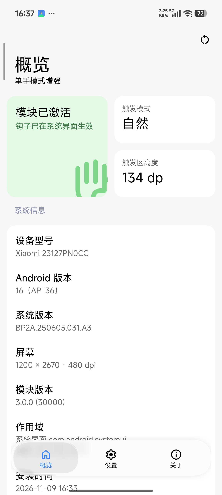
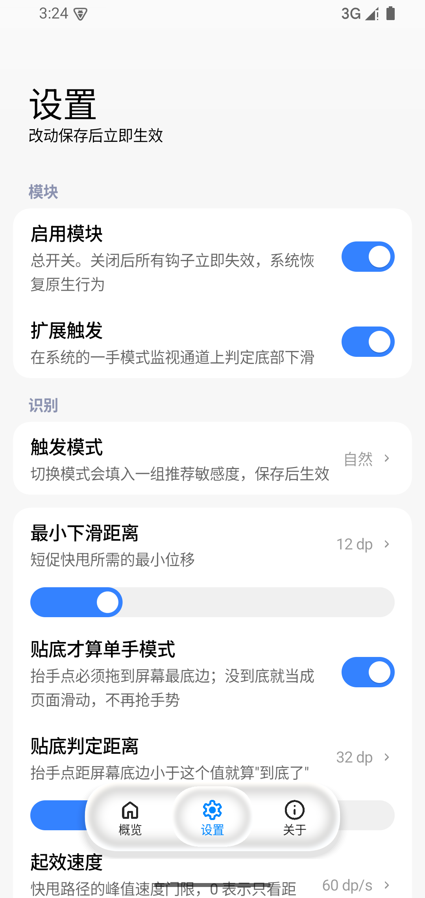
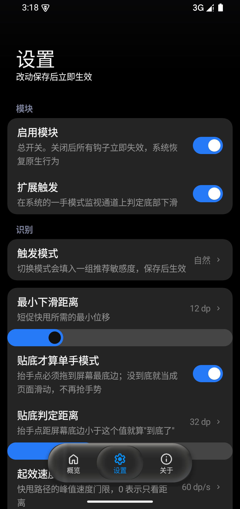

# 界面设计稿对照（HyperOS / Miuix）

设置界面参照 [SonyPods](https://github.com/Mercury000/SonyPods) 的观感。它是 Kotlin + Jetpack Compose，用的是
[Miuix KMP](https://github.com/compose-miuix-ui/miuix)（`top.yukonga:miuix`）——也就是 HyperOS 的设计语言组件库。
液态玻璃底栏移植自 [AndroidLiquidGlass](https://github.com/Kyant0/AndroidLiquidGlass) 的 `LiquidBottomTabs`。

本项目不引入 Compose，也不引入 AndroidX：`module/` 里没有 `res/`（只有一张头像与图标），
构建脚本只做 `javac → d8 → aapt2 link → apksigner`。
所以这里把 Miuix 的 token 逐条抄成常量，再用原生 View 画出来（`Theme.java` + `Ui.java`）。

## 截图

| 概览 | 浅色 | 深色 |
|---|---|---|
|  |  |  |

## 颜色

来源：`miuix-ui/src/commonMain/kotlin/top/yukonga/miuix/kmp/theme/Colors.kt`

| 语义 | Miuix 字段 | 浅色 | 深色 | 用在哪 |
|---|---|---|---|---|
| 页面底色 | `surface` | `#F7F7F7` | `#000000` | `ScrollView` 背景 |
| 卡片 | `surfaceContainer` | `#FFFFFF` | `#242424` | `Card` 背景 |
| 行标题 | `onSurface` | `#000000` | `#F2F2F2` | 17sp Medium 标题 |
| 行摘要 | `onSurfaceVariantSummary` | `#99000000` | `#80FFFFFF` | 14sp 摘要 |
| 行尾值 / 箭头 | `onSurfaceVariantActions` | `#66000000` | `#66FFFFFF` | 数值、chevron |
| 段落标题 | `onBackgroundVariant` | `#8C93B0` | `#787E96` | `SmallTitle` |
| 强调色 | `primary` | `#3482FF` | `#277AF7` | 开关、主按钮、滑杆、底栏指示器 |
| 次按钮底 | `secondaryVariant` | `#F0F0F0` | `#434343` | 「恢复默认参数」 |
| 开关关闭轨道 | `secondary` | `#E6E6E6` | `#505050` | 关闭态 |
| 玻璃底栏底 | `surface @ 40%` | `#FAFAFA 62%` | `#121212 62%` | 底栏本体 |
| 成功态 | SonyPods StatusCard | `#DFFAE4 / #36D167` | `#16301F / #5BD07E` | 概览状态卡 |

## 尺寸与排版

来源：`TextStyles.kt` / `Component.kt` / `SmallTitle.kt` / `Card.kt` / `Switch.kt` / `Button.kt` /
`TopAppBar.kt` / `DialogContentLayout.kt`

| 元素 | Miuix | 本项目实现 |
|---|---|---|
| 大标题 | `TopAppBar`，title1 32sp Normal，`TitlePadding 26dp` | 自绘 `TopBar`：32sp，左内缩 26dp，随滚动折叠 |
| 收起标题 | title3 20sp Medium，`CollapsedHeight 52dp` | 20sp Medium，滚动 76dp 后完全显现并加分隔线 |
| 副标题 | body2 14sp `onSurfaceVariantSummary` | 14sp，与大标题间隔 4dp |
| 段落标题 | `SmallTitle` subtitle 14sp **Bold** | 14sp Bold，内边距 14/14/14/6（页面 12dp → 左边 26dp） |
| 卡片 | `Card`，`cornerRadius 16dp`，squircle，无阴影 | 16dp squircle（`Squircle.D`）+ `clipToOutline` |
| 行 | `BasicComponent` minHeight 56dp，`insideMargin 16dp` | 同尺寸，**行与行之间不画分隔线**（与 HyperOS 设置页一致） |
| 行标题 | headline1 17sp Medium | 17sp `sans-serif-medium` |
| 行摘要 | body2 14sp | 14sp，与标题间距 3dp |
| 行尾值 | body2 14sp `onSurfaceVariantActions` | 14sp，值 + 单位同色 |
| 箭头 | `ArrowRight` 10×16dp | Material `chevron_right` 14dp，`onSurfaceVariantActions` |
| 开关 | 49×28dp，圆钮 20dp（关 4 / 开 25） | 同尺寸；轨道 spring(438.6, 0.99)、圆钮 spring(987, 0.7) |
| 按钮 | `TextButton` minHeight 40dp，`cornerRadius 16dp`，17sp | 44~48dp（单手更好按），16dp 圆角，17sp Medium |
| 对话框 | `WindowDialog` 32dp 圆角、inside 24dp、maxWidth 420dp | 同规格；按钮竖排（primary 在上） |
| 页面 | `LazyColumn` 内容边距 12dp、卡片间距 12dp | `ScrollView` + 12dp 页边距、12dp 卡片间距 |
| 玻璃底栏 | `LiquidBottomTabs`：64dp 高、内边距 4dp、指示器 56dp | 同尺寸；图标 22dp + 11sp 文字，胶囊指示器 |

## 液态玻璃底栏

源码是 Compose + `drawBackdrop`（vibrancy → blur → lens + BloomStroke 高光 + InnerShadow，
外加 DampedDragAnimation 的弹簧手势）。本项目是原生 View，结构对齐 Kyant0 的
`LiquidBottomTabs`，**折射与边缘光直接移植手机上 `io.github.hyperisland` 的实现**
（`LiquidGlassDrawable.REFRACTION_SHADER` + `LiquidGlassEdgeHighlight.SDR_EDGE_SHADER`）：

| 层 | 源码 | 本项目 |
|---|---|---|
| 玻璃体 | `vibrancy() → blur(8dp) → lens(24dp, 24dp)` | 页面内容按 0.5 采样 → 可分离盒式模糊（9dp）→ 折射 AGSL；叠色 `white @ 8%` |
| 折射 | 圆角矩形 SDF + `circleMap` 位移 + RGB 分离采样 | 同一条 shader：`uRefractionHeight = 0.16 × min(w,h) × 1.25`、`uRefractionAmount = -0.16 × min(w,h) × 2`、色散 `0.18 × 0.12` |
| 边缘高光 | `SDR_EDGE_SHADER`：SDF 梯度当法线 × 光照方向 | 同一颗 shader，光向 `(-0.45, -0.89)`；迎光边亮、背光边暗，另有一条 `lensBand` |
| 折射层 | alpha=0 的强调色图标层，只参与透镜采样 | 选中项的强调色图标画在指示器之上 |
| 指示器 | 56dp 胶囊，`lens(10dp·p, 14dp·p)` | 同尺寸；折射带宽与位移随按下/速度放大，像推一颗水珠 |
| 投影 | `Shadow(radius 10dp)`，亮 0.1 / 暗 0.2 | 同参数 |

> **两个必须记住的坑**
>
> 1. **先模糊，再折射。** 顺序反了，位移采样到的都是带文字的锐利像素，
>    边缘会被撕成一圈彩色条纹。
> 2. **AGSL 里所有局部变量名必须全局唯一。** Skia 会把辅助函数内联进 `main`，
>    两个函数各自的 `q` / `distance` 内联后落在同一作用域，直接报 `redefinition`，
>    整颗 shader 编译失败并静默退化成"只有模糊"。这就是之前"液态玻璃完全不是一回事"的根因。

## 折叠标题栏：渐进式模糊

对应 miuix 的 `ProgressiveBlur.Top`（`angle / startFraction / endFraction / curve`）。
做法不是"整体上移淡出"，而是：

1. 抓标题栏底下那一条内容，按 7~12dp 模糊（折叠越深半径越小）；
2. 用一层自底向上的 alpha 遮罩把模糊衰减到 0，与内容无缝衔接；
3. 最上面再压一层极淡的面色（0.40 → 0.74，随折叠加深），保证彩色背景上标题仍读得清。

> 底色不能用 `pal.bg`：演示模式下它是全透明，`setColor()` 之后再 `setAlpha()`
> 会画出一条黑带。

## 与 Miuix 的差异

- **字体**：用系统 `sans-serif` / `sans-serif-medium`；HyperOS 上这两个 alias 就是 MiSans（100~950 可变字重），
  所以实机观感与系统设置一致。
- **没有 sink / tilt 按压反馈**：用 `RippleDrawable` + 0.965 缩放代替。
- **不做手动主题切换**：深浅色跟随系统 `uiMode`，切换时重建 Activity 避免两套 token 混用。
- **折叠标题栏是自绘的**：没有 NestedScrollConnection，由 `ScrollView.getScrollY()` 驱动。

## 触感

基线是 Android 的 `View.performHapticFeedback`，但澎湃 OS 的线性马达有一整套专用效果 id
（`miui.view.MiuiHapticFeedbackConstants`，`FLAG_MIUI_HAPTIC | n`）。本项目按场景分别下发，
不用 `VibrationEffect` 合成波形（那样听感/手感都像转子马达）：

| 场景 | 效果 |
|---|---|
| 点按钮 / 行 | `TAP_LIGHT` |
| 主按钮（保存、确定） | `BUTTON_MIDDLE` |
| 开关切换 | `SWITCH` |
| 底栏换页 / 页面滑动吸附 | `FLICK_LIGHT` |
| 滚动到边界 | `SCROLL_EDGE` |
| 滑杆每一格 | `MESH_LIGHT` |
| 弹出菜单 | `POPUP_LIGHT` |

下发顺序：`miuix.util.HapticFeedbackCompat#performHapticFeedback(int)` 反射 →
`View.performHapticFeedback` → `VibrationEffect.Composition` → 单次波形，逐级退化。
32ms 节流，且尊重系统的「触感反馈」开关。

## 交互

| 操作 | 行为 |
|---|---|
| 点开关行的任意位置 | 切换开关（对齐 `SwitchPreference`） |
| 拖数值行下面的滑杆 | 实时改值（对齐 `SliderPreference` 的 bottomAction），每格 `MESH_LIGHT` 触感 |
| 点数值行 | 弹出滑杆对话框，范围与步长按参数定义 |
| 对话框「确定」 | 只改本地显示值，并浮出「保存并立即生效」胶囊 |
| 「保存并立即生效」 | 一次性广播到 SystemUI，写入 `Settings.Global` |
| 「恢复默认参数」 | 回到默认值并立即提交 |
| 底部三格 | 拖拽切换页面（指示器跟手 + 橡皮筋位移），松手按最近一格吸附 |

## 数值范围

| 参数 | 范围 | 步长 | 单位 |
|---|---|---|---|
| 触发区高度 | 20 ~ 200 | 1 | dp |
| 最小下滑距离 | 1 ~ 60 | 1 | dp |
| 有效宽度占比 | 20 ~ 100 | 5 | % |
| 起效速度 | 0 ~ 800 | 10 | dp/s |
| 最大横向偏移 | 0.5 ~ 4.0 | 0.1 | 倍 |
| 触发冷却 | 0 ~ 2000 | 50 | ms |
| 原生胶囊条高度 | 0 ~ 40 | 1 | dp |

